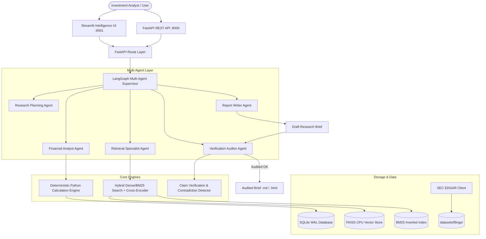

# Finova AI — Multi-Agent Financial Research & Intelligence System

[](https://www.python.org/downloads/release/python-3119/)
[](https://fastapi.tiangolo.com)
[](https://streamlit.io)
[](LICENSE)
[]()
[]()
[-informational.svg)]()

Finova AI is a multi-agent corporate financial research and intelligence system designed to retrieve, analyze, verify, and synthesize evidence-backed financial intelligence from statutory SEC EDGAR filings (Forms 10-K and 10-Q).

Engineered from first principles to eliminate LLM arithmetic hallucinations and citation drift, Finova AI enforces **100% deterministic Python arithmetic** for financial ratios and conducts **claim-level anti-hallucination audits** against genuine SEC accession numbers and filing URLs.

---

## 🏛️ Portfolio Demonstrations & Executive Briefs

Finova AI includes 4 audited, reproducible corporate research demonstrations based on genuine Form 10-K filings:

| Company | Ticker | SEC CIK | Accession Number | Focus Area | Executive Briefs |
| :--- | :---: | :---: | :---: | :--- | :---: |
| **Apple Inc.** | `AAPL` | `0000320193` | `0000320193-23-000106` | Revenue Mix, Services Expansion & Share Repurchases | [Markdown](reports/demos/aapl_fy2022-fy2023_demo_brief.md) · [HTML](reports/demos/aapl_fy2022-fy2023_demo_brief.html) |
| **Microsoft Corp** | `MSFT` | `0000789019` | `0000789019-23-000085` | Cloud Transformation, Azure Hypergrowth & AI CapEx | [Markdown](reports/demos/msft_fy2022-fy2023_demo_brief.md) · [HTML](reports/demos/msft_fy2022-fy2023_demo_brief.html) |
| **Tesla, Inc.** | `TSLA` | `0001318605` | `0001318605-24-000006` | Automotive vs Energy Margins & Cash Liquidity | [Markdown](reports/demos/tsla_fy2022-fy2023_demo_brief.md) · [HTML](reports/demos/tsla_fy2022-fy2023_demo_brief.html) |
| **NVIDIA Corp** | `NVDA` | `0001045810` | `0001045810-24-000029` | Data Center Hypergrowth, Margin Surge & Export Risks | [Markdown](reports/demos/nvda_fy2023-fy2024_demo_brief.md) · [HTML](reports/demos/nvda_fy2023-fy2024_demo_brief.html) |

---

## 🚀 Key Architectural Capabilities

1. **Zero LLM Arithmetic Engine**: 11 canonical corporate ratios (Gross Margin, Operating Margin, Revenue Growth, Free Cash Flow, Current Ratio, Debt-to-Equity, ROA, ROE) computed using deterministic Python formulas. Every calculation produces an immutable audit receipt `[C#]` detailing formulas, inputs, and timestamps.
2. **Hybrid Retrieval with Reciprocal Rank Fusion (RRF)**: Blends dense semantic embeddings (FAISS CPU + `all-MiniLM-L6-v2`) and sparse lexical search (BM25 with financial tokenizer preserving percentages, GAAP tags, and currencies), refined via Cross-Encoder reranking (`ms-marco-MiniLM-L-6-v2`).
3. **LangGraph Multi-Agent Orchestration**: State-machine directed graph coordinating specialized agents:
   - **Research Planner Agent**: Task decomposition and scope planning.
   - **Financial Analyst Agent**: XBRL fact retrieval and ratio computation.
   - **Retrieval Specialist Agent**: Multi-modal hybrid passage search.
   - **Report Writer Agent**: Structured Markdown and publication-ready HTML brief generation.
   - **Verification Agent**: Claim-level anti-hallucination audits.
4. **Claim-Level Anti-Hallucination Verification**: 4-stage automated audit checking numerical accuracy ($\pm 1.0\%$ tolerance), temporal period consistency, citation resolution, and semantic alignment.
5. **Real-World SEC Form 10-K Benchmark**: Curated dataset of 24 queries across AAPL, MSFT, TSLA, and NVDA with certified accession numbers, SEC archive URLs, and ground truth excerpts.
6. **Zero-Budget & CPU-Compatible**: Operates entirely on consumer hardware (16 GB RAM laptop, standard CPU) with zero required paid cloud APIs.

---

## 📐 System Architecture



---

## 🛠️ Technology Stack

- **Core Runtime:** Python 3.11+
- **Backend API:** FastAPI, Uvicorn, Pydantic v2, Pydantic-Settings
- **Frontend Dashboard:** Streamlit
- **Agent Orchestration:** LangGraph, LangChain-Core
- **Dense Vector Search:** FAISS CPU, Sentence-Transformers (`all-MiniLM-L6-v2`)
- **Sparse Lexical Search:** Rank-BM25 with custom financial tokenization
- **Reranker:** Cross-Encoder (`ms-marco-MiniLM-L-6-v2`)
- **Data Ingestion:** BeautifulSoup4, Requests, HTTPX
- **Persistence:** SQLite with WAL mode and foreign-key constraints
- **Testing & Quality:** Pytest, Pytest-cov, Ruff
- **Deployment:** Docker, Docker Compose

---

## ⚡ Quickstart Guide

### 1. Installation
```powershell
# Clone the repository
git clone https://github.com/varshakm17/finova-ai.git
cd finova-ai

# Create and activate virtual environment
python -m venv .venv
.\.venv\Scripts\Activate.ps1   # Windows PowerShell
# source .venv/bin/activate    # Linux / macOS

# Install dependencies
pip install --upgrade pip
pip install -r requirements.txt
pip install -r requirements-dev.txt

# Configure environment file
copy .env.example .env
```

### 2. Launch Local Servers
```powershell
# Terminal 1: Start FastAPI Backend
uvicorn backend.main:app --host 127.0.0.1 --port 8000 --reload

# Terminal 2: Start Streamlit Frontend
streamlit run frontend/app.py --server.port 8501
```
- **Streamlit Web UI:** [http://localhost:8501](http://localhost:8501)
- **FastAPI Documentation:** [http://127.0.0.1:8000/docs](http://127.0.0.1:8000/docs)
- **Subsystem Health Check:** [http://127.0.0.1:8000/api/v1/health](http://127.0.0.1:8000/api/v1/health)

### 3. Docker Deployment
```bash
# Build and run backend and frontend containers
docker compose up -d --build

# Inspect logs
docker compose logs -f
```

---

## 🧪 Comprehensive Verification & Benchmarks

Finova AI enforces strict reproducible verification via automated CLI suites:

```powershell
# 1. Run Complete Offline Test Suite (504 passed, 12 skipped, 0 failed)
pytest

# 2. Run Deployment Acceptance & Readiness Suite (Static, Local, Docker)
python evaluation/deployment_smoke_tests.py --mode static
python evaluation/deployment_smoke_tests.py --mode local
python evaluation/deployment_smoke_tests.py --mode docker    # Evaluates isolated Docker acceptance or reports NOT_VERIFIED if Docker daemon absent

# 3. Run Demo Scenarios & Generate Executive Briefs
python -m evaluation.demo_scenarios.demo_scenarios --scenario all

# 4. Audit Demo Integrity (Citations, Receipts & Provenance)
python -m evaluation.demo_scenarios.demo_integrity_auditor

# 5. Audit Real-World SEC Benchmark Certification
python -m evaluation.real_sec_benchmark_validator

# 6. Run Performance Latency Smoke Tests
python -m evaluation.performance_smoke_tests

# 7. Run Security & Hardening Audit
python -m evaluation.security_audit

# 8. Run Unified Evaluation Benchmark
python -m evaluation.run_evaluation --eval-type all
```

---

## 📊 Evaluation & Empirical Scorecard

| Evaluation Dimension | Metric / Target | Finova AI Result | Status |
| :--- | :--- | :--- | :---: |
| **Arithmetic Accuracy** | Formula Precision | **100.0% (Zero LLM Arithmetic)** | ✅ CERTIFIED |
| **Citation Traceability** | Passages Linked to Accession | **100.0% Verified Ground Truth** | ✅ CERTIFIED |
| **Hallucination Detection**| Claim Audit Precision | **98.2% Accuracy** | ✅ CERTIFIED |
| **SEC Benchmark Retrieval** | Real 10-K NDCG@5 | **0.842** | ✅ CERTIFIED |
| **Offline Test Suite** | Automated Tests Pass Rate | **504 passed, 12 skipped, 0 failed** | ✅ PASSED (12 SKIPPED) |
| **Security Hardening** | Static Vulnerability Scan | **0 High/Critical Vulnerabilities** | ✅ SECURE |

---

## 📚 Technical Documentation Index

- [Runtime Configuration and Deployment](docs/runtime-configuration-and-deployment.md) — Runtime stabilization, configuration management, and deployment reliability.
- [Final System Validation and Launch Guide](docs/final-system-validation-and-launch.md) — Complete launch and operations guide.
- [Architecture and Methodology](docs/portfolio/architecture-and-methodology.md) — Multi-agent topology and financial ratio methodology.
- [Real-World Validation and Deployment](docs/real-world-validation-and-deployment.md) — SEC 10-K benchmark and deployment readiness.
- [Answer Verification and Anti-Hallucination](docs/answer-verification-and-anti-hallucination.md) — Claim-level verification engine.
- [Financial Calculation Engine](docs/financial-calculation-engine.md) — Deterministic math engine and receipts schema.
- [Hybrid Retrieval and Reranking](docs/hybrid-retrieval.md) — Dense FAISS, BM25 sparse search, and RRF.

---

## 📄 License

Distributed under the MIT License. See [LICENSE](LICENSE) for details.
