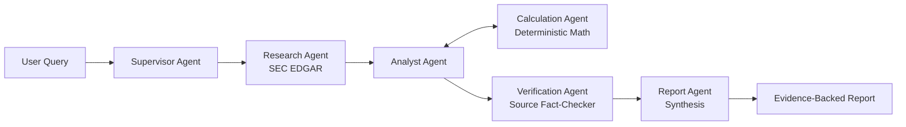

# Finova AI — Multi-Agent Financial Research and Intelligence System

[](https://www.python.org/downloads/release/python-3119/)
[](https://fastapi.tiangolo.com)
[](https://streamlit.io)
[](LICENSE)
[]()

Finova AI is a modular, production-oriented financial intelligence platform designed to extract, compute, cross-verify, and synthesize evidence-backed corporate financial research from SEC EDGAR company filings (Forms 10-K and 10-Q).

---

## 1. Problem Statement

Financial research requires analyzing hundreds of pages of complex statutory disclosures, footnotes, and balance sheets. Traditional LLM-based solutions suffer from severe vulnerabilities in financial contexts:
- **Hallucinated figures**: Fabricating financial numbers or confusing quarterly with annual results.
- **Arithmetic errors**: Inaccurate financial ratios, margins, and compound growth calculations.
- **Untraceable assertions**: Presenting quantitative insights without exact filing coordinates or citations.
- **Information obsolescence**: Inability to systematically trace multi-year performance across changing accounting standards.

Finova AI solves these limitations through an orchestrated multi-agent architecture where retrieval, arithmetic calculation, domain analysis, and source verification are rigorously segregated.

---

## 2. Project Objectives

- **Automated Filing Retrieval**: Directly fetch primary annual (10-K) and quarterly (10-Q) filings from the SEC EDGAR system.
- **Deterministic Metric Extraction**: Parse structured financial statements (Operations, Balance Sheets, Cash Flows) with XBRL tagging.
- **Pure Arithmetic Calculation**: Compute growth rates, profitability margins, liquidity metrics, and valuation ratios using verified deterministic code rather than LLM text generation.
- **Longitudinal & Cross-Company Benchmarking**: Compare financial performance across multiple fiscal years and industry peers.
- **Hybrid RAG for Qualitative Footnotes**: Query risk factors (Item 1A) and Management Discussion & Analysis (Item 7) with dense and sparse vector retrieval.
- **Anti-Hallucination Verification**: Cross-verify every numerical statement against the underlying SEC disclosure prior to report generation.
- **Evidence-Backed Reporting**: Produce comprehensive research briefs complete with page references and line-item coordinates.

---

## 3. Major Features

1. **SEC EDGAR Client Engine**: Compliant rate-limited ingestion of SEC company facts and full-text filings with automatic backoff retries.
2. **Company Identification & Ticker Resolution**: In-memory and disk-cached CIK resolution from master SEC directory.
3. **XBRL Metric Extraction & Temporal Normalization**: Section-aware parsing that separates Annual, Standalone Quarterly, Year-To-Date (YTD), and Point-in-Time Instant values.
4. **Relational SQLite Financial Store**: Foreign-key backed persistence layer for companies, filings, and canonical financial observations.
5. **Interactive Streamlit Workspace**: Multi-view dashboard for company lookup, filing inspection, and financial metric tracking.
6. **Multi-Agent Orchestration Graph (LangGraph)**: *(Planned: Session 05)* 6-agent cooperative state machine.
7. **Deterministic Financial Math Library**: *(Planned: Session 04)* Calculation receipts ensuring zero arithmetic errors.

---

## 4. Technology Stack

- **Runtime & Language**: Python 3.11
- **Backend Framework**: FastAPI (Asynchronous REST API, OpenAPI/Swagger)
- **Frontend Framework**: Streamlit (Interactive Financial Analytics Dashboard)
- **Configuration Management**: Pydantic Settings (Environment-driven configuration)
- **Data & Computation**: Pandas, NumPy
- **HTTP & Networking**: Requests, HTTPX
- **Testing & Quality**: Pytest, Pytest-cov, Ruff
- **Database (Initial)**: SQLite with foreign keys enabled (Zero external infrastructure dependency)
- **Execution Target**: Standard CPU execution (16 GB RAM, no GPU required)
- **Planned Orchestration**: LangGraph, Local Embeddings, Hybrid BM25

---

## 5. System Architecture Overview



For detailed architectural specifications, agent definitions, sequence diagrams, and data ingestion workflows:
- [architecture.md](file:///c:/Users/LENOVO/OneDrive/Desktop/Finova%20AI/docs/architecture.md) — Multi-agent system topology.
- [sec-data-pipeline.md](file:///c:/Users/LENOVO/OneDrive/Desktop/Finova%20AI/docs/sec-data-pipeline.md) — Ingestion pipeline and schema specification.

---

## 6. Repository Structure

```
finova-ai/
│
├── backend/
│   ├── __init__.py
│   ├── main.py                 # FastAPI application factory and entrypoint
│   ├── api/
│   │   ├── __init__.py
│   │   └── routes.py           # REST API endpoints (Health, Companies, Filings, Financials)
│   ├── data/                   # SEC EDGAR ingestion, normalization, and SQLite storage
│   │   ├── __init__.py
│   │   ├── sec_client.py       # Rate-limited SEC EDGAR HTTP client with backoff
│   │   ├── company_service.py  # Ticker-to-CIK resolution and caching
│   │   ├── financial_extractor.py # XBRL company facts parser & US-GAAP mapper
│   │   ├── data_normalizer.py  # Observation schema and period classification
│   │   └── storage.py          # SQLite relational database engine
│   ├── agents/                 # (Session 05) Multi-agent implementations
│   │   └── __init__.py
│   ├── graph/                  # (Session 05) LangGraph state graphs
│   │   └── __init__.py
│   ├── retrieval/              # (Session 03) Hybrid RAG pipelines
│   │   └── __init__.py
│   ├── finance/                # (Session 04) Deterministic financial calculation
│   │   └── __init__.py
│   ├── evaluation/             # (Session 06) Benchmarks and quality metrics
│   │   └── __init__.py
│   └── utils/
│       ├── __init__.py
│       └── logger.py           # Centralized console and rotating file logger
│
├── frontend/
│   ├── __init__.py
│   └── app.py                  # Streamlit application with company lookup & analytics
│
├── config/
│   ├── __init__.py
│   └── settings.py             # Pydantic Settings configuration loader
│
├── datasets/
│   ├── README.md               # Guidelines for raw filing storage and cache
│   └── cache/                  # Local cache for SEC ticker directory
│
├── notebooks/
│   └── .gitkeep                # Exploratory analysis scratchpads
│
├── tests/
│   ├── __init__.py
│   ├── fixtures/
│   │   └── sec_mock_data.py    # Mock SEC submissions and facts payloads
│   ├── test_health.py          # Foundation & health check tests
│   ├── test_sec_client.py      # SECClient, CIK, and User-Agent validation tests
│   ├── test_company_service.py # Company lookup and caching tests
│   ├── test_financial_extractor.py # XBRL extraction & period typing tests
│   ├── test_storage.py         # SQLite persistence, foreign keys, & upsert tests
│   └── test_api_endpoints.py   # FastAPI company & financial endpoint tests
│
├── docs/
│   ├── architecture.md         # System architecture specification
│   └── sec-data-pipeline.md    # SEC data ingestion & retrieval specification
│
├── logs/
│   ├── .gitkeep
│   └── finova.log              # Application runtime logs
│
├── .env.example                # Environment variable template
├── .gitignore                  # Git exclusions for secrets, venvs, and cache
├── requirements.txt            # Core runtime dependencies
├── requirements-dev.txt        # Development and testing dependencies
├── README.md                   # Project documentation
└── LICENSE                     # MIT License
```

---

## 7. SEC EDGAR Integration & Supported Metrics

### Supported Canonical Financial Concepts
- **Income Statement**: Revenue, Cost of Revenue, Gross Profit, Operating Income, Net Income, Earnings Per Share (Diluted/Basic).
- **Balance Sheet (Instant)**: Total Assets, Current Assets, Total Liabilities, Current Liabilities, Stockholders' Equity, Cash and Cash Equivalents, Long-Term Debt.
- **Cash Flow Statement**: Operating Cash Flow, Investing Cash Flow, Financing Cash Flow, Capital Expenditures (Capex).

### Fair-Access Compliance
- **Declared User-Agent**: Configured via `SEC_USER_AGENT` environment variable. Format: `ApplicationName AdminContact@domain.com`.
- **Throttling**: Enforces $\le 8$ requests/second.
- **Exponential Backoff**: Automatic retry for HTTP 429 and 5xx errors.

---

## 8. REST API Endpoints & Examples

The FastAPI backend exposes interactive Swagger UI at `http://127.0.0.1:8000/docs`.

### 1. Company Search
- **Endpoint**: `GET /api/v1/companies/search?ticker=AAPL`
- **Response**:
  ```json
  {
    "ticker": "AAPL",
    "cik": "0000320193",
    "name": "Apple Inc."
  }
  ```

### 2. Company Metadata
- **Endpoint**: `GET /api/v1/companies/AAPL`
- **Response**:
  ```json
  {
    "ticker": "AAPL",
    "cik": "0000320193",
    "name": "Apple Inc.",
    "sic": "3571",
    "sic_description": "Electronic Computers",
    "fiscal_year_end": "0930",
    "state_location": "CA"
  }
  ```

### 3. Recent SEC Filings
- **Endpoint**: `GET /api/v1/companies/AAPL/filings?form_type=10-K`
- **Response**:
  ```json
  [
    {
      "accession_number": "0000320193-23-000106",
      "cik": "0000320193",
      "form": "10-K",
      "filing_date": "2023-11-03",
      "report_date": "2023-09-30",
      "primary_document": "aapl-20230930.htm",
      "is_xbrl": true,
      "url": "https://www.sec.gov/Archives/edgar/data/320193/000032019323000106/aapl-20230930.htm"
    }
  ]
  ```

### 4. Normalized Financial Observations
- **Endpoint**: `GET /api/v1/companies/AAPL/financials?period_type=annual&start_year=2023`
- **Response**:
  ```json
  [
    {
      "company_ticker": "AAPL",
      "company_cik": "0000320193",
      "company_name": "Apple Inc.",
      "metric_name": "Revenue",
      "statement_type": "Income Statement",
      "original_tag": "us-gaap:RevenueFromContractWithCustomerExcludingAssessedTax",
      "numeric_value": 383285000000.0,
      "unit": "USD",
      "period_start": "2022-10-01",
      "period_end": "2023-09-30",
      "period_type": "annual",
      "fiscal_year": 2023,
      "fiscal_period": "FY",
      "filing_date": "2023-11-03",
      "filing_type": "10-K",
      "accession_number": "0000320193-23-000106",
      "source_url": "https://www.sec.gov/Archives/edgar/data/320193/000032019323000106/"
    }
  ]
  ```

### 5. Metric History
- **Endpoint**: `GET /api/v1/companies/AAPL/financials/Revenue`
- **Response**: List of chronological observations specifically for `Revenue`.

---

## 9. Windows Installation & Execution

### 1. Activate Environment
```powershell
.\.venv\Scripts\Activate.ps1
```

### 2. Configure Environment Variables
Copy `.env.example` to `.env`:
```powershell
Copy-Item .env.example .env
```
Ensure `SEC_USER_AGENT` contains a valid contact email:
```ini
SEC_USER_AGENT="FinovaAI-Research/0.1.0 (contact@example.com)"
```

### 3. Run FastAPI Backend
```powershell
uvicorn backend.main:app --host 127.0.0.1 --port 8000 --reload
```

### 4. Run Streamlit Frontend
```powershell
streamlit run frontend/app.py
```

### 5. Run Automated Tests
```powershell
pytest -v --cov=backend --cov=config
```

---

## 10. Implementation Status

- [x] Standardized project repository layout with separation of concerns.
- [x] Python 3.11 virtual environment configuration.
- [x] Centralized configuration management using Pydantic Settings (`config/settings.py`).
- [x] Centralized logging system writing to console and `logs/finova.log` (`backend/utils/logger.py`).
- [x] Operational FastAPI backend with `/health` and `/api/v1/health` endpoints (`backend/main.py`).
- [x] SEC EDGAR Client with User-Agent validation, rate-limiting, and backoff (`backend/data/sec_client.py`).
- [x] Company identification, ticker normalization, and disk caching (`backend/data/company_service.py`).
- [x] Financial data extraction for 17 canonical US-GAAP concepts (`backend/data/financial_extractor.py`).
- [x] Period typing distinguishing Annual, Standalone Quarter, YTD, and Instant (`backend/data/data_normalizer.py`).
- [x] Relational SQLite storage with foreign keys and unique constraints (`backend/data/storage.py`).
- [x] REST API endpoints for search, metadata, filings, and financials (`backend/api/routes.py`).
- [x] Streamlit company and financial metrics lookup UI (`frontend/app.py`).
- [x] Automated test suite with 32 unit and integration tests passing offline (`tests/`).
- [x] Comprehensive documentation in `README.md` and `docs/sec-data-pipeline.md`.

---

## 11. Future Development Roadmap

- **Session 03: Hybrid RAG & Financial Document Processing**
  - Section-aware financial filing chunking (Item 1A Risk Factors, Item 7 MD&A).
  - CPU-optimized embedding generation.
  - BM25 + dense hybrid search over filing disclosures.
- **Session 04: Deterministic Financial Calculation Engine**
  - Strict Python implementations of financial ratios and margin formulas.
  - Execution receipts with line-item traceability.
- **Session 05: LangGraph Multi-Agent Orchestration**
  - 6-agent cooperative state graph.
  - Bidirectional verification and anti-hallucination auditor.
- **Session 06: Production UI & Full Report Generation**
  - Interactive financial dashboard.
  - Exportable PDF research briefs with source citations.

---

## 12. License

Distributed under the MIT License. See [LICENSE](file:///c:/Users/LENOVO/OneDrive/Desktop/Finova%20AI/LICENSE) for more details.
