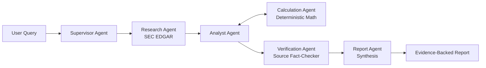

# Finova AI — Multi-Agent Financial Research and Intelligence System

[](https://www.python.org/downloads/release/python-3119/)
[](https://fastapi.tiangolo.com)
[](https://streamlit.io)
[](LICENSE)
[]()
[-brightgreen.svg)]()

Finova AI is a modular, production-oriented financial intelligence platform designed to extract, compute, cross-verify, and synthesize evidence-backed corporate financial research from SEC EDGAR company filings (Forms 10-K and 10-Q).

---

## 1. Problem Statement

Financial research requires analyzing hundreds of pages of complex statutory disclosures, footnotes, and balance sheets. Traditional LLM-based solutions suffer from severe vulnerabilities in financial contexts:
- **Hallucinated figures**: Fabricating financial numbers or confusing quarterly with annual results.
- **Arithmetic errors**: Inaccurate financial ratios, margins, and compound growth calculations.
- **Untraceable assertions**: Presenting quantitative insights without exact filing coordinates or citations.
- **Information obsolescence**: Inability to systematically trace multi-year performance across changing accounting standards.

Finova AI solves these limitations through an orchestrated multi-agent architecture where retrieval, arithmetic calculation, domain analysis, and source verification are rigorously segregated.

---

## 2. Project Objectives

- **Automated Filing Retrieval**: Directly fetch primary annual (10-K) and quarterly (10-Q) filings from the SEC EDGAR system.
- **Deterministic Metric Extraction**: Parse structured financial statements (Operations, Balance Sheets, Cash Flows) with XBRL tagging.
- **Document Preprocessing & Section Extraction**: Extract clean, readable text from HTML/inline XBRL filings, isolate core sections (Item 1, 1A, 7, 7A), and bypass Table of Contents false-positives.
- **Section-Aware Chunking**: Segment narrative disclosures into boundary-aware, overlapping chunks preserving full filing provenance and character coordinates.
- **Pure Arithmetic Calculation**: Compute growth rates, profitability margins, liquidity metrics, and valuation ratios using verified deterministic code rather than LLM text generation.
- **Longitudinal & Cross-Company Benchmarking**: Compare financial performance across multiple fiscal years and industry peers.
- **Hybrid RAG for Qualitative Footnotes**: Query risk factors (Item 1A) and Management Discussion & Analysis (Item 7) with dense and sparse vector retrieval.
- **Anti-Hallucination Verification**: Cross-verify every numerical statement against the underlying SEC disclosure prior to report generation.
- **Evidence-Backed Reporting**: Produce comprehensive research briefs complete with page references and line-item coordinates.

---

## 3. Major Features

1. **SEC EDGAR Client Engine**: Compliant rate-limited ingestion of SEC company facts and full-text filings with automatic backoff retries.
2. **Company Identification & Ticker Resolution**: In-memory and disk-cached CIK resolution from master SEC directory.
3. **XBRL Metric Extraction & Temporal Normalization**: Section-aware parsing that separates Annual, Standalone Quarterly, Year-To-Date (YTD), and Point-in-Time Instant values.
4. **Statutory Document Ingestion Pipeline**: Compliant downloading and local caching of primary 10-K and 10-Q HTML documents with domain whitelisting and SHA-256 integrity checks.
5. **HTML & Inline XBRL Normalization**: BeautifulSoup parser stripping scripts, styles, comments, and hidden trackers while unwrapping inline XBRL tags and formatting tables into pipe-separated structures.
6. **Heuristic Section Extraction**: Identifies and extracts canonical Items 1, 1A, 7, and 7A across Form 10-K and 10-Q structures while rejecting Table of Contents false-positives.
7. **Section-Aware Chunking Engine**: Generates ~3,500-char chunks (~400 overlap) snapping cleanly to paragraph or sentence boundaries with full citation metadata.
8. **Relational SQLite Store**: Foreign-key backed persistence layer for companies, filings, financial observations, documents, sections, and chunks.
9. **Interactive Streamlit Workspace**: Multi-view dashboard for company lookup, filing metadata, numerical metric exploration, document ingestion/chunk inspection, and deterministic financial calculations.
10. **Deterministic Financial Math & Calculation Receipts Engine**: Pure Python arithmetic calculation engine computing 10 core financial metrics (Revenue Growth, Margins, Current Ratio, Debt-to-Equity, ROA, ROE, FCF) with zero LLM arithmetic hallucinations.
11. **Verifiable Audit Receipts**: Complete mathematical transparency tracking formula expressions, input observations, accession numbers, and SEC archive URLs.
12. **Multi-Agent Orchestration Graph (LangGraph)**: *(Planned: Session 05)* 6-agent cooperative state machine.

---

## 4. Technology Stack

- **Runtime & Language**: Python 3.11
- **Backend Framework**: FastAPI (Asynchronous REST API, OpenAPI/Swagger)
- **Frontend Framework**: Streamlit (Interactive Financial Analytics Dashboard)
- **Document Processing**: BeautifulSoup4 (Standard zero-C html.parser)
- **Configuration Management**: Pydantic Settings (Environment-driven configuration)
- **Data & Computation**: Pandas, NumPy
- **HTTP & Networking**: Requests, HTTPX
- **Testing & Quality**: Pytest, Pytest-cov, Ruff
- **Database**: SQLite with foreign keys enabled (Zero external infrastructure dependency)
- **Execution Target**: Standard CPU execution (16 GB RAM, no GPU required)
- **Planned Orchestration**: LangGraph, Local Embeddings, Hybrid BM25

---

## 5. System Architecture Overview



For detailed architectural specifications, agent definitions, sequence diagrams, and data ingestion workflows:
- [architecture.md](file:///c:/Users/LENOVO/OneDrive/Desktop/Finova%20AI/docs/architecture.md) — Multi-agent system topology.
- [sec-data-pipeline.md](file:///c:/Users/LENOVO/OneDrive/Desktop/Finova%20AI/docs/sec-data-pipeline.md) — Numerical XBRL ingestion pipeline and schema specification.
- [filing-ingestion.md](file:///c:/Users/LENOVO/OneDrive/Desktop/Finova%20AI/docs/filing-ingestion.md) — Document downloading, HTML parsing, section extraction, and chunking specification.
- [financial-calculation-engine.md](file:///c:/Users/LENOVO/OneDrive/Desktop/Finova%20AI/docs/financial-calculation-engine.md) — Deterministic financial arithmetic engine, receipts schema, and API specification.
- [embeddings-and-vector-indexing.md](file:///c:/Users/LENOVO/OneDrive/Desktop/Finova%20AI/docs/embeddings-and-vector-indexing.md) — Local sentence embeddings, persistent FAISS/NumPy indexing, and dense semantic search.
- [hybrid-retrieval.md](file:///c:/Users/LENOVO/OneDrive/Desktop/Finova%20AI/docs/hybrid-retrieval.md) — BM25 sparse search, domain-aware financial tokenization, and Reciprocal Rank Fusion (RRF).

---

## 6. Repository Structure

```
finova-ai/
│
├── backend/
│   ├── __init__.py
│   ├── main.py                 # FastAPI application factory and entrypoint
│   ├── api/
│   │   ├── __init__.py
│   │   └── routes.py           # REST API endpoints (Health, Companies, Ingestion, Chunks, Calculations)
│   ├── data/                   # SEC EDGAR ingestion, document processing, and storage
│   │   ├── __init__.py
│   │   ├── sec_client.py       # Rate-limited SEC EDGAR HTTP client with backoff
│   │   ├── company_service.py  # Ticker-to-CIK resolution and caching
│   │   ├── filing_downloader.py # Secure SEC document downloader with file caching
│   │   ├── html_parser.py      # HTML/inline-XBRL parser and table formatter
│   │   ├── section_extractor.py # 10-K / 10-Q section isolation and TOC filter
│   │   ├── chunker.py          # Boundary-aware, section-aware text chunker
│   │   ├── document_storage.py # SQLite storage engine for documents, sections, chunks
│   │   ├── filing_ingestion_service.py # Orchestrator for end-to-end filing ingestion
│   │   ├── financial_extractor.py # XBRL company facts parser & US-GAAP mapper
│   │   ├── data_normalizer.py  # Observation schema and period classification
│   │   └── storage.py          # SQLite relational database engine
│   ├── finance/                # Deterministic financial calculation engine & receipts
│   │   ├── __init__.py
│   │   ├── calculation_engine.py # Pure arithmetic methods for all 10 financial metrics
│   │   ├── calculation_models.py # Pydantic schemas for receipts, inputs, and requests
│   │   ├── period_validator.py   # Flow/instant period alignment & unit validation
│   │   └── calculation_service.py # Multi-period calculation & persistence coordinator
│   ├── retrieval/              # Multi-modal retrieval pipelines (Dense, Sparse BM25, and Hybrid RRF)
│   │   ├── __init__.py
│   │   ├── bm25_indexing_service.py # Incremental BM25 indexer with content hashing
│   │   ├── bm25_search.py       # FinancialBM25 (smoothed IDF) and domain tokenizer
│   │   ├── embedding_service.py # Lazy-loading CPU SentenceTransformers (all-MiniLM-L6-v2)
│   │   ├── hybrid_search.py     # Reciprocal Rank Fusion blending dense and sparse lists
│   │   ├── indexing_service.py  # Incremental, hash-based vector indexing coordinator
│   │   ├── retrieval_models.py  # Pydantic schemas for Dense, BM25, and Hybrid retrieval
│   │   ├── semantic_search.py   # Dense vector search with metadata post-filtering
│   │   ├── text_preprocessor.py # Financial text cleaning, context prefixing, and SHA-256
│   │   └── vector_store.py      # Dual vector store backends: FAISS CPU & NumPy
│   ├── evaluation/             # Retrieval diagnostics and evaluation suites
│   │   ├── __init__.py
│   │   └── retrieval_diagnostics.py # Overlap metrics, Jaccard ratio, and synthetic benchmark
│   ├── agents/                 # (Session 07) Multi-agent implementations
│   │   └── __init__.py
│   ├── graph/                  # (Session 07) LangGraph state graphs
│   │   └── __init__.py
│   └── utils/
│       ├── __init__.py
│       └── logger.py           # Centralized console and rotating file logger
│
├── frontend/
│   ├── __init__.py
│   └── app.py                  # Streamlit application with multi-modal hybrid search workspace
│
├── config/
│   ├── __init__.py
│   └── settings.py             # Pydantic Settings configuration loader
│
├── datasets/
│   ├── README.md               # Guidelines for raw filing storage and cache
│   ├── cache/                  # Local cache for SEC ticker directory
│   ├── filings/                # Local cache for downloaded SEC HTML filings (git-ignored)
│   └── indexes/                # Persistent vector indexes and BM25 JSON corpus (git-ignored)
│
├── notebooks/
│   └── .gitkeep                # Exploratory analysis scratchpads
│
├── tests/
│   ├── __init__.py
│   ├── fixtures/
│   │   ├── sec_mock_data.py    # Mock SEC submissions and facts payloads
│   │   └── sec_html_fixtures.py # Mock 10-K, 10-Q, and inline-XBRL HTML fixtures
│   ├── test_health.py          # Foundation & health check tests
│   ├── test_sec_client.py      # SECClient, CIK, and User-Agent validation tests
│   ├── test_company_service.py # Company lookup and caching tests
│   ├── test_financial_extractor.py # XBRL extraction & period typing tests
│   ├── test_storage.py         # SQLite persistence, foreign keys, & upsert tests
│   ├── test_api_endpoints.py   # FastAPI company & financial endpoint tests
│   ├── test_filing_downloader.py # Download validation, caching, and host checks
│   ├── test_html_parser.py     # HTML cleaning, inline XBRL, and table format tests
│   ├── test_section_extractor.py # 10-K/10-Q section boundaries and TOC rejection tests
│   ├── test_chunker.py         # Boundary alignment, overlap, and deterministic tests
│   ├── test_document_storage.py # Document, section, and chunk persistence tests
│   ├── test_filing_ingestion_service.py # End-to-end ingestion pipeline tests
│   ├── test_api_ingestion_endpoints.py # FastAPI filing ingestion and chunk routes
│   ├── test_calculation_engine.py # Pure formula arithmetic & zero-division tests
│   ├── test_period_validator.py # Period alignment, floating calendar, & unit tests
│   ├── test_calculation_storage.py # SQLite calculation receipts persistence & upsert tests
│   ├── test_calculation_service.py # Multi-year calculation & edge-case integration tests
│   ├── test_api_calculations.py # FastAPI calculation endpoints & validation tests
│   ├── test_text_preprocessor.py # Text cleaning, context prefix, and hashing tests
│   ├── test_embedding_service.py # Lazy-loading, L2-norm, and mock encoder tests
│   ├── test_vector_store.py    # FAISS and NumPy vector store persistence & search tests
│   ├── test_indexing_service.py # Incremental, update, and force-reindex tests
│   ├── test_semantic_search.py # Dense semantic search & metadata filtering tests
│   ├── test_api_embeddings.py  # FastAPI semantic search & indexing route tests
│   ├── test_financial_tokenizer.py # Financial token, percentage, currency preservation tests
│   ├── test_bm25_search.py     # BM25Index persistence, search, and provenance tests
│   ├── test_bm25_indexing_service.py # Incremental BM25 updates and rebuild tests
│   ├── test_hybrid_search.py   # Reciprocal Rank Fusion math, degraded-mode, and tie-breaking tests
│   ├── test_retrieval_diagnostics.py # Overlap metrics, Jaccard ratio, and benchmark suite tests
│   └── test_api_hybrid_search.py # FastAPI BM25 & hybrid search endpoint tests
│
├── docs/
│   ├── architecture.md         # System architecture specification
│   ├── sec-data-pipeline.md    # SEC data ingestion & retrieval specification
│   ├── filing-ingestion.md     # Document ingestion, section extraction, and chunking
│   └── financial-calculation-engine.md # Deterministic calculation engine & receipts
│
├── logs/
│   ├── .gitkeep
│   └── finova.log              # Application runtime logs
│
├── .env.example                # Environment variable template
├── .gitignore                  # Git exclusions for secrets, venvs, and filing downloads
├── requirements.txt            # Core runtime dependencies
├── requirements-dev.txt        # Development and testing dependencies
├── README.md                   # Project documentation
└── LICENSE                     # MIT License
```

---

## 7. Statutory Document Ingestion & Section-Aware Chunking

### Supported Filing Types
- **Form 10-K**: Annual reports (Item 1 Business, Item 1A Risk Factors, Item 7 MD&A, Item 7A Market Risk).
- **Form 10-Q**: Quarterly reports (Part I Item 2 MD&A, Part I Item 3 Market Risk, Part II Item 1A Risk Factors).

### HTML Normalization & Table Formatting
- Eliminates script, style, comments, and hidden tracking snippets.
- Unrolls inline XBRL structures (`<ix:nonFraction>`, `<ix:nonNumeric>`) without losing numerical text or adding unwanted line breaks.
- Formats tabular data into clean pipe-delimited text (`Col 1 | Col 2 | Col 3`).

### Table of Contents (TOC) Traps & Heuristic Rejection
TOC listings with identical headings are rejected by evaluating character distance to the next item (`min_section_chars=150`).

### Section-Aware Chunking Strategy
- Target chunk size: **3,500 characters** with **400 character overlap**.
- Natural boundary preservation: Breaks at paragraph boundaries (`\n\n`) or sentence terminators (`. `, `! `, `? `).
- Provenance: Every chunk stores ticker, CIK, accession number, filing form, section ID, title, character offsets, and source URL.

---

## 8. REST API Endpoints & Examples

The FastAPI backend exposes interactive Swagger UI at `http://127.0.0.1:8000/docs`.

### 1. Ingest SEC Filing
- **Endpoint**: `POST /api/v1/companies/AAPL/filings/0000320193-23-000106/ingest`
- **Query Params**: `force_refresh=false`
- **Response**:
  ```json
  {
    "document_id": "0000320193_000032019323000106",
    "ticker": "AAPL",
    "cik": "0000320193",
    "company_name": "Apple Inc.",
    "accession_number": "0000320193-23-000106",
    "filing_type": "10-K",
    "filing_date": "2023-11-03",
    "report_date": "2023-09-30",
    "processing_status": "completed",
    "sections_extracted": ["ITEM_1", "ITEM_1A", "ITEM_7", "ITEM_7A"],
    "sections_not_found": [],
    "total_chunks": 14,
    "document_hash": "a4d95f8e...",
    "file_size_bytes": 1824050,
    "warnings": []
  }
  ```

### 2. List Ingested Documents
- **Endpoint**: `GET /api/v1/companies/AAPL/documents?filing_type=10-K`
- **Response**: List of previously ingested document summaries.

### 3. Get Ingested Document Details
- **Endpoint**: `GET /api/v1/companies/AAPL/documents/0000320193-23-000106`
- **Response**: Metadata, extracted section extraction statuses, character counts, and total chunks.

### 4. Retrieve Document Chunks
- **Endpoint**: `GET /api/v1/companies/AAPL/documents/0000320193-23-000106/chunks?section_identifier=ITEM_1A`
- **Response**: Section-aware chunks with full provenance and character offsets.

### 5. Trigger Deterministic Financial Calculations
- **Endpoint**: `POST /api/v1/companies/AAPL/calculations?period_type=annual`
- **Query / Body Params**: `start_year` (optional), `end_year` (optional), `period_type` (`annual` or `quarterly`), `metrics` (optional list of metric keys)
- **Response**:
  ```json
  {
    "ticker": "AAPL",
    "cik": "0000320193",
    "company_name": "Apple Inc.",
    "period_type": "annual",
    "total_calculated": 9,
    "total_unavailable": 1,
    "total_invalid": 0,
    "calculations": [
      {
        "calculation_id": "0000320193_gross_profit_margin_annual_2023-09-30",
        "metric_name": "gross_profit_margin",
        "calculated_value": 44.1311,
        "unit": "percentage",
        "period_end": "2023-09-30",
        "formula_expression": "(Gross Profit / Revenue) * 100",
        "status": "calculated",
        "inputs": [ ... ],
        "warnings": []
      }
    ]
  }
  ```

### 6. List Stored Calculation Receipts
- **Endpoint**: `GET /api/v1/companies/AAPL/calculations?period_type=annual`
- **Query Params**: `metric_name`, `start_year`, `end_year`, `period_type`
- **Response**: List of persisted `CalculationReceipt` records.

### 7. Get Calculation Receipt by ID
- **Endpoint**: `GET /api/v1/calculations/{calculation_id}`
- **Response**: Complete verifiable audit receipt with formula, input observations, accession numbers, and SEC archive URLs.

### 8. Trigger Incremental Chunk Indexing
- **Endpoint**: `POST /api/v1/companies/{ticker}/embeddings/index`
- **Query / Body Params**: `filing_type` (optional), `accession_number` (optional), `force_reindex` (boolean)
- **Response**: Summary of chunks discovered, newly indexed, updated, already indexed (skipped), and indexing duration.

### 9. Check Company Embedding Status
- **Endpoint**: `GET /api/v1/companies/{ticker}/embeddings/status`
- **Response**: Total chunks, indexed count, pending count, failed count, model name, backend, and last index timestamp.

### 10. Dense Semantic Search
- **Endpoint**: `POST /api/v1/search/semantic`
- **Body Params**: `query` (string), `ticker` (optional), `filing_type` (optional), `section_identifier` (optional), `top_k` (default 5), `similarity_threshold` (default 0.30)
- **Response**: List of scored semantic chunks with full filing provenance, section title, and cosine similarity score.

### 11. Diagnostic Vector Store Statistics
- **Endpoint**: `GET /api/v1/index/stats`
- **Response**: Active backend name (`faiss` / `numpy`), vector count, dimension (384), index directory path, and list of indexed tickers.

### 12. Trigger Incremental BM25 Sparse Indexing
- **Endpoint**: `POST /api/v1/companies/{ticker}/bm25/index`
- **Query / Body Params**: `filing_type` (optional), `accession_number` (optional), `force_reindex` (boolean)
- **Response**: Summary of chunks discovered, newly tokenized, updated, already indexed (skipped), and indexing duration.

### 13. Check Company BM25 Index Status
- **Endpoint**: `GET /api/v1/companies/{ticker}/bm25/status`
- **Response**: Total chunks, indexed count, pending count, total tokens, average chunk length, and last index timestamp.

### 14. Sparse Lexical Search (BM25)
- **Endpoint**: `POST /api/v1/search/sparse`
- **Body Params**: `query` (string), `ticker` (optional), `filing_type` (optional), `section_identifier` (optional), `top_k` (default 5)
- **Response**: Ranked list of BM25 lexical matches with raw BM25 scores, matched terms list, and full filing provenance.

### 15. Hybrid Search with Reciprocal Rank Fusion (RRF)
- **Endpoint**: `POST /api/v1/search/hybrid`
- **Body Params**: `query` (string), `ticker` (optional), `filing_type` (optional), `section_identifier` (optional), `top_k` (default 5), `rrf_constant` (default 60), `dense_limit` (default 50), `sparse_limit` (default 50)
- **Response**: Fused search results sorted by descending RRF score, individual dense and sparse ranks/scores, retrieval source tags (`["dense", "sparse"]`), and operational diagnostics.

### 16. Diagnostic BM25 Index Statistics
- **Endpoint**: `GET /api/v1/index/bm25/stats`
- **Response**: Total chunks, tokenizer version, vocabulary size, average document length, and indexed tickers.

---

## 9. Windows Installation & Execution

### 1. Activate Environment
```powershell
.\.venv\Scripts\Activate.ps1
```

### 2. Configure Environment Variables
Copy `.env.example` to `.env`:
```powershell
Copy-Item .env.example .env
```
Ensure `SEC_USER_AGENT` contains a valid contact email:
```ini
SEC_USER_AGENT="FinovaAI-Research/0.1.0 (contact@example.com)"
```

### 3. Run FastAPI Backend
```powershell
uvicorn backend.main:app --host 127.0.0.1 --port 8000 --reload
```

### 4. Run Streamlit Frontend
```powershell
streamlit run frontend/app.py
```

### 5. Run Automated Tests
```powershell
pytest -v --cov=backend --cov=config
```

---

## 10. Implementation Status

- [x] Standardized project repository layout with separation of concerns.
- [x] Python 3.11 virtual environment configuration.
- [x] Centralized configuration management using Pydantic Settings (`config/settings.py`).
- [x] Centralized logging system writing to console and `logs/finova.log` (`backend/utils/logger.py`).
- [x] Operational FastAPI backend with health and metadata endpoints (`backend/main.py`).
- [x] SEC EDGAR Client with User-Agent validation, rate-limiting, and backoff (`backend/data/sec_client.py`).
- [x] Company identification, ticker normalization, and disk caching (`backend/data/company_service.py`).
- [x] Financial data extraction for 17 canonical US-GAAP concepts (`backend/data/financial_extractor.py`).
- [x] Period typing distinguishing Annual, Standalone Quarter, YTD, and Instant (`backend/data/data_normalizer.py`).
- [x] Relational SQLite storage with foreign keys and unique constraints (`backend/data/storage.py`).
- [x] Secure SEC filing HTML downloader with host validation and local caching (`backend/data/filing_downloader.py`).
- [x] HTML & inline XBRL parser with table preservation and markup cleaning (`backend/data/html_parser.py`).
- [x] Section extractor for Items 1, 1A, 7, 7A across 10-K and 10-Q with TOC rejection (`backend/data/section_extractor.py`).
- [x] Boundary-aware text chunker with paragraph/sentence snapping and provenance (`backend/data/chunker.py`).
- [x] Document, section, and chunk SQLite storage engine with foreign keys (`backend/data/document_storage.py`).
- [x] End-to-end filing ingestion service orchestrator (`backend/data/filing_ingestion_service.py`).
- [x] FastAPI filing ingestion, document listing, detail, and chunk retrieval endpoints (`backend/api/routes.py`).
- [x] Streamlit filing selection, ingestion status, section breakdown, and chunk inspector UI (`frontend/app.py`).
- [x] Pure Python deterministic arithmetic calculation engine for 10 financial metrics (`backend/finance/calculation_engine.py`).
- [x] Strict period alignment validator with 7-day floating fiscal calendar tolerance and unit verification (`backend/finance/period_validator.py`).
- [x] Verifiable calculation receipts (`CalculationReceipt`) tracking exact formulas and provenance (`backend/finance/calculation_models.py`).
- [x] Relational persistence in SQLite `financial_calculations` with compound unique constraints (`backend/data/storage.py`).
- [x] Calculation execution and receipt retrieval REST endpoints (`backend/api/routes.py`).
- [x] Interactive Streamlit Financial Analysis workspace with summary scorecards and receipts inspector (`frontend/app.py`).
- [x] CPU-optimized local embeddings with `all-MiniLM-L6-v2` (384 dimensions) and lazy initialization (`backend/retrieval/embedding_service.py`).
- [x] Financial text preprocessor with context metadata prefixing and dual SHA-256 hash tracking (`backend/retrieval/text_preprocessor.py`).
- [x] Persistent vector store backends: FAISS CPU (`IndexFlatIP`) and pure NumPy fallback (`backend/retrieval/vector_store.py`).
- [x] SQLite `chunk_embeddings` schema, foreign keys, and change-detection queries (`backend/data/document_storage.py`).
- [x] Incremental indexing service skipping unchanged chunks and updating modified chunks (`backend/retrieval/indexing_service.py`).
- [x] Dense semantic search service with over-fetch candidate filtering, top-k, and threshold cutoffs (`backend/retrieval/semantic_search.py`).
- [x] REST endpoints for chunk indexing, embedding status, semantic search, and index stats (`backend/api/routes.py`).
- [x] Streamlit semantic search explorer & indexing control dashboard (`frontend/app.py`).
- [x] Comprehensive documentation in `README.md`, `docs/sec-data-pipeline.md`, `docs/filing-ingestion.md`, `docs/financial-calculation-engine.md`, `docs/embeddings-and-vector-indexing.md`, and `docs/hybrid-retrieval.md`.
- [x] Financial domain tokenizer preserving currencies, percentages, dates, statutory codes, and hyphenated terms (`backend/retrieval/bm25_search.py`).
- [x] FinancialBM25 sparse index with Robertson/Lucene smoothed IDF and safe JSON persistence (`backend/retrieval/bm25_search.py`).
- [x] SQLite `bm25_index_metadata` schema and incremental content-hash change detection (`backend/data/document_storage.py`).
- [x] Incremental BM25 indexing service supporting company-scoping, filing filters, and rebuilds (`backend/retrieval/bm25_indexing_service.py`).
- [x] Reciprocal Rank Fusion (RRF) hybrid search engine with deterministic tie-breaking and degraded-mode fault tolerance (`backend/retrieval/hybrid_search.py`).
- [x] REST endpoints for BM25 indexing, status, lexical search, hybrid RRF search, and sparse stats (`backend/api/routes.py`).
- [x] Multi-modal Streamlit search workspace supporting Hybrid (RRF), Dense, and BM25 modes with diagnostic metrics (`frontend/app.py`).
- [x] Diagnostic evaluation suite analyzing candidate overlap, Jaccard similarity, rank shifts, and synthetic benchmark suite (`backend/evaluation/retrieval_diagnostics.py`).
- [x] Automated test suite with 184 unit and integration tests passing offline with 90% coverage (`tests/`).

---

## 11. Future Development Roadmap

- **Session 07: LangGraph Multi-Agent Orchestration & Anti-Hallucination Verification**
  - 6-agent cooperative state graph with Supervisor, Research, Analyst, Calculation, Verification, and Report agents.
  - Bidirectional verification and anti-hallucination fact auditor cross-checking math and text against SEC citations.
- **Session 08: Production UI & Full Report Generation**
  - Interactive multi-agent financial workspace.
  - Exportable PDF research briefs with source citations and audit receipts.

---

## 12. License

Distributed under the MIT License. See [LICENSE](file:///c:/Users/LENOVO/OneDrive/Desktop/Finova%20AI/LICENSE) for more details.
