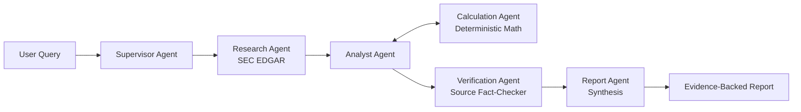

# Finova AI — Multi-Agent Financial Research and Intelligence System

[](https://www.python.org/downloads/release/python-3119/)
[](https://fastapi.tiangolo.com)
[](https://streamlit.io)
[](LICENSE)
[]()

Finova AI is a modular, production-oriented financial intelligence platform designed to extract, compute, cross-verify, and synthesize evidence-backed corporate financial research from SEC EDGAR company filings (Forms 10-K and 10-Q).

---

## 1. Problem Statement

Financial research requires analyzing hundreds of pages of complex statutory disclosures, footnotes, and balance sheets. Traditional LLM-based solutions suffer from severe vulnerabilities in financial contexts:
- **Hallucinated figures**: Fabricating financial numbers or confusing quarterly with annual results.
- **Arithmetic errors**: Inaccurate financial ratios, margins, and compound growth calculations.
- **Untraceable assertions**: Presenting quantitative insights without exact filing coordinates or citations.
- **Information obsolescence**: Inability to systematically trace multi-year performance across changing accounting standards.

Finova AI solves these limitations through an orchestrated multi-agent architecture where retrieval, arithmetic calculation, domain analysis, and source verification are rigorously segregated.

---

## 2. Project Objectives

- **Automated Filing Retrieval**: Directly fetch primary annual (10-K) and quarterly (10-Q) filings from the SEC EDGAR system.
- **Deterministic Metric Extraction**: Parse structured financial statements (Operations, Balance Sheets, Cash Flows) with XBRL tagging.
- **Pure Arithmetic Calculation**: Compute growth rates, profitability margins, liquidity metrics, and valuation ratios using verified deterministic code rather than LLM text generation.
- **Longitudinal & Cross-Company Benchmarking**: Compare financial performance across multiple fiscal years and industry peers.
- **Hybrid RAG for Qualitative Footnotes**: Query risk factors (Item 1A) and Management Discussion & Analysis (Item 7) with dense and sparse vector retrieval.
- **Anti-Hallucination Verification**: Cross-verify every numerical statement against the underlying SEC disclosure prior to report generation.
- **Evidence-Backed Reporting**: Produce comprehensive research briefs complete with page references and line-item coordinates.

---

## 3. Planned Major Features

1. **SEC EDGAR Client Engine**: Compliant rate-limited ingestion of SEC company facts and full-text filings.
2. **Multi-Agent Orchestration Graph (LangGraph)**: Coordination across 6 specialized agents (Supervisor, Research, Analyst, Calculation, Verification, Report).
3. **Deterministic Financial Math Library**: Comprehensive financial formula suite ensuring zero calculation errors.
4. **Hybrid Sparse + Dense Vector Search**: BM25 keyword matching fused with dense embeddings for high-precision footnote lookup.
5. **Interactive Research Workspace**: Streamlit-based UI for interactive company benchmarking, filing inspection, and report generation.
6. **Extensible FastAPI Microservice**: Robust asynchronous REST API exposing all research capabilities.

---

## 4. Technology Stack

- **Runtime & Language**: Python 3.11
- **Backend Framework**: FastAPI (Asynchronous REST API, OpenAPI/Swagger)
- **Frontend Framework**: Streamlit (Interactive Financial Analytics Dashboard)
- **Configuration Management**: Pydantic Settings (Environment-driven configuration)
- **Data & Computation**: Pandas, NumPy
- **HTTP & Networking**: Requests, HTTPX
- **Testing & Quality**: Pytest, Pytest-cov, Ruff
- **Database (Initial)**: SQLite (Zero external infrastructure dependency)
- **Execution Target**: Standard CPU execution (16 GB RAM, no GPU required)
- **Planned Orchestration**: LangGraph, Local Embeddings, Hybrid BM25

---

## 5. System Architecture Overview



For detailed architectural specifications, agent definitions, and sequence diagrams, refer to [architecture.md](file:///c:/Users/LENOVO/OneDrive/Desktop/Finova%20AI/docs/architecture.md).

---

## 6. Repository Structure

```
finova-ai/
│
├── backend/
│   ├── __init__.py
│   ├── main.py                 # FastAPI application factory and entrypoint
│   ├── api/
│   │   ├── __init__.py
│   │   └── routes.py           # API endpoints (including /health)
│   ├── agents/                 # (Session 05) Multi-agent implementations
│   │   └── __init__.py
│   ├── graph/                  # (Session 05) LangGraph state graphs
│   │   └── __init__.py
│   ├── data/                   # (Session 02) SEC EDGAR ingestion & parsing
│   │   └── __init__.py
│   ├── retrieval/              # (Session 03) Hybrid RAG pipelines
│   │   └── __init__.py
│   ├── finance/                # (Session 04) Deterministic financial calculation
│   │   └── __init__.py
│   ├── evaluation/             # (Session 06) Benchmarks and quality metrics
│   │   └── __init__.py
│   └── utils/
│       ├── __init__.py
│       └── logger.py           # Centralized console and rotating file logger
│
├── frontend/
│   ├── __init__.py
│   └── app.py                  # Streamlit application with financial theme
│
├── config/
│   ├── __init__.py
│   └── settings.py             # Pydantic Settings configuration loader
│
├── datasets/
│   └── README.md               # Guidelines for raw filing storage and cache
│
├── notebooks/
│   └── .gitkeep                # Exploratory analysis scratchpads
│
├── tests/
│   ├── __init__.py
│   └── test_health.py          # Automated test suite (health checks, config)
│
├── docs/
│   └── architecture.md         # Detailed architectural documentation
│
├── logs/
│   └── .gitkeep                # Application runtime logs
│
├── .env.example                # Environment variable template
├── .gitignore                  # Git exclusions for secrets, venvs, and cache
├── requirements.txt            # Core runtime dependencies
├── requirements-dev.txt        # Development and testing dependencies
├── README.md                   # Project documentation
└── LICENSE                     # MIT License
```

---

## 7. Windows Installation Instructions

### Prerequisites
- Windows 10/11
- Python 3.11 installed and added to your `PATH`
- Git

### 1. Create Virtual Environment
Open PowerShell in the project directory:

```powershell
python -m venv .venv
```

### 2. Activate Virtual Environment
```powershell
.\.venv\Scripts\Activate.ps1
```

*Note: If PowerShell displays an execution policy error, enable local script execution for the current session:*
```powershell
Set-ExecutionPolicy -ExecutionPolicy RemoteSigned -Scope Process
```

### 3. Install Dependencies
```powershell
# Install core runtime and development dependencies
pip install --upgrade pip
pip install -r requirements-dev.txt
```

---

## 8. Environment Variable Configuration

Copy the `.env.example` template to `.env`:

```powershell
Copy-Item .env.example .env
```

Key configuration parameters in `.env`:

| Variable | Default Value | Description |
| :--- | :--- | :--- |
| `APP_NAME` | `Finova AI` | Name of the application |
| `APP_ENV` | `development` | Deployment environment (`development`, `staging`, `production`, `test`) |
| `DEBUG` | `True` | Enable debug logs and hot reload |
| `HOST` | `127.0.0.1` | Local backend host binding |
| `PORT` | `8000` | Local backend port |
| `LOG_LEVEL` | `INFO` | Console & file log threshold (`DEBUG`, `INFO`, `WARNING`, `ERROR`) |
| `DATABASE_URL`| `sqlite:///./finova.db` | Local SQLite database URL |
| `SEC_USER_AGENT` | `FinovaAI-Research/0.1.0 (contact@example.com)` | **Required for SEC EDGAR requests**: declare your name/entity and contact email |

---

## 9. Execution Instructions

### A. Running the FastAPI Backend
With the virtual environment activated:

```powershell
uvicorn backend.main:app --host 127.0.0.1 --port 8000 --reload
```

- **API Base URL**: `http://127.0.0.1:8000`
- **Interactive Swagger Documentation**: `http://127.0.0.1:8000/docs`
- **Alternative ReDoc Documentation**: `http://127.0.0.1:8000/redoc`
- **Direct Health Check**: `http://127.0.0.1:8000/health`

### B. Running the Streamlit Frontend
In a separate PowerShell terminal (with `.venv` activated):

```powershell
streamlit run frontend/app.py
```

The Streamlit web interface will open automatically in your browser at:
`http://localhost:8501`

---

## 10. Running Automated Tests

Run the test suite using `pytest`:

```powershell
pytest
```

To run with verbose output and coverage reporting:

```powershell
pytest -v --cov=backend --cov=config
```

---

## 11. Current Implementation Status (Session 01)

- [x] Standardized project repository layout with separation of concerns.
- [x] Python 3.11 virtual environment configuration.
- [x] Centralized configuration management using Pydantic Settings (`config/settings.py`).
- [x] Centralized logging system writing to console and `logs/finova.log` (`backend/utils/logger.py`).
- [x] Operational FastAPI backend with `/health` and `/api/v1/health` endpoints (`backend/main.py`).
- [x] Exception handling and OpenAPI / Swagger UI documentation.
- [x] Minimal Streamlit frontend with dark navy theme and backend connectivity indicator (`frontend/app.py`).
- [x] Automated test suite verifying health endpoints, config defaults, and logging (`tests/test_health.py`).
- [x] Comprehensive architecture documentation (`docs/architecture.md`).
- [x] Strict scope boundary preservation (zero premature agent or scraping implementations).

---

## 12. Future Development Roadmap

- **Session 02: SEC EDGAR Ingestion Pipeline**
  - Rate-limited SEC EDGAR API client.
  - CIK company lookup and 10-K / 10-Q XBRL parsing.
  - Local caching layer for raw corporate filings.
- **Session 03: Hybrid RAG & Financial Document Processing**
  - Section-aware financial filing chunking.
  - CPU-optimized embedding generation.
  - BM25 + dense hybrid search over filing disclosures.
- **Session 04: Deterministic Financial Calculation Engine**
  - Strict Python implementations of financial ratios and margin formulas.
  - Execution receipts with line-item traceability.
- **Session 05: LangGraph Multi-Agent Orchestration**
  - 6-agent cooperative state graph.
  - Bidirectional verification and anti-hallucination auditor.
- **Session 06: Production UI & Full Report Generation**
  - Interactive financial dashboard.
  - Exportable PDF research briefs with source citations.

---

## 13. License

Distributed under the MIT License. See [LICENSE](file:///c:/Users/LENOVO/OneDrive/Desktop/Finova%20AI/LICENSE) for more details.

