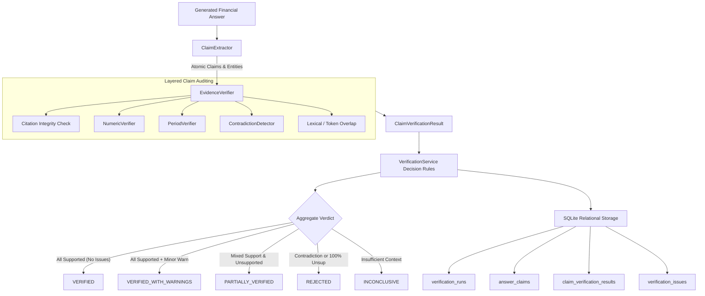

# Finova AI — Anti-Hallucination Verification & Claim-Level Evidence Validation

## 1. Executive Summary & Anti-Hallucination Philosophy

In statutory corporate finance and securities research, factual accuracy is non-negotiable. Large Language Models (LLMs) frequently exhibit hallucinations, numerical scale confusion (such as stating thousands when millions were intended), temporal divergence (citing FY2022 disclosures for FY2023 queries), and directional fabrications (asserting revenue growth when sales actually contracted).

Finova AI addresses this structural challenge through **Session 09: Anti-Hallucination Verification & Claim-Level Evidence Validation**. Rather than relying on soft prompt engineering or another LLM self-evaluation loop, Finova AI implements a **deterministic, rule-grounded, multi-layered claim auditor**. Every generated financial research answer undergoes atomic segmentation into independently verifiable assertions, which are cross-examined against retrieved SEC filing passages and deterministic XBRL calculation receipts.

### Core Architectural Principles
1. **Deterministic Primacy**: Arithmetic tolerance checks, scale errors, and period consistency checks are executed strictly in Python without probabilistic LLM calculations.
2. **Provenance Traceability**: Citations are mapped to statutory SEC EDGAR accession numbers, section identifiers, and calculation receipt identifiers. Fabricated or dangling citation IDs are explicitly flagged and penalized.
3. **Multi-Horizon Temporal Auditing**: Statements asserting annual or fiscal year conclusions are validated against reporting dates, quarter tags, and filing forms (10-K vs 10-Q).
4. **Directional Integrity**: Opposing directional terms (e.g. "expanded" vs "contracted", "rose" vs "declined") are audited against source text to eliminate inverted narratives.
5. **Heuristic Confidence Scored**: Confidence scores reflect deterministic heuristic coverage metrics, not probabilistic claims of statistical certainty.

---

## 2. System Architecture & Verification Lifecycle

---

## 3. Core Engine Components

### 3.1. Claim Extractor (`ClaimExtractor`)
Located in `backend/verification/claim_extractor.py`, this module transforms continuous generation output into discrete assertions:
- **Abbreviation Protection**: Uses regex boundary masking (`@@DOT@@`) to ensure abbreviations like `Inc.`, `Corp.`, `U.S.`, `FY2023.`, `$100.5M`, `e.g.`, and `i.e.` do not trigger false sentence terminations.
- **Citation Linking**: Extracts prompt citation markers (e.g. `[E1]`, `[C1]`, `[E2, C1]`) and cleanly maps them to individual claims while preserving original character offsets.
- **Quantitative Entity Extraction**: Parses amounts, currency symbols, percentages, and multipliers (`billion`, `million`, `thousand`, `bps`, `%`).
- **Fiscal Period & Company Detection**: Detects mentioned companies (tickers, names) and calendar/fiscal time horizons (`FY2023`, `Q3 2023`, `2023-09-30`).
- **Categorization**: Classifies assertions into `FINANCIAL_METRIC`, `HISTORICAL_COMPARISON`, `TREND_DIRECTION`, `FORWARD_LOOKING`, `RISK_OR_BUSINESS`, `PERFORMANCE_STATEMENT`, or `GENERAL_FACT`.

### 3.2. Deterministic Numerical Verifier (`NumericVerifier`)
Located in `backend/verification/numeric_verifier.py`, this engine audits quantitative claims:
- **Exact & Relative Tolerance Matching**: Evaluates numerical proximity using a configurable relative tolerance (default `1.0%`).
- **Scale Error Detection**: Identifies 1,000x and 1,000,000x discrepancies (e.g. stating `$383,285 million` when SEC filings state `$383,285 thousand`).
- **Percentage vs Decimal Fraction Confusion**: Detects 100x scale errors where decimals were confused with percentages (e.g. claiming `0.298%` instead of `29.8%` or `0.298`).
- **Sign Inversions**: Detects direction and polarity reversals (e.g. claiming positive `+15.0%` when statutory calculation receipt is negative `-15.0%`).
- **Receipt Auditing**: Directly matches formula definitions and output fields against deterministic XBRL execution receipts.

### 3.3. Reporting Period Consistency Verifier (`PeriodVerifier`)
Located in `backend/verification/period_verifier.py`:
- **Fiscal Year Alignment**: Verifies that the claimed period (e.g. `FY2023`) matches the statutory report date and filing date of cited documents.
- **Frequency Discrepancy Detection**: Flags when an annual assertion (e.g. `FY2023 annual sales`) cites a quarterly Form 10-Q filing.
- **Quarter Mismatch Detection**: Distinguishes between quarterly reporting intervals (e.g. Q1 vs Q3) within quarterly reports.

### 3.4. Contradiction Detection Engine (`ContradictionDetector`)
Located in `backend/verification/contradiction_detector.py`:
- **Directional Opposition**: Compares affirmative and negative trajectory tokens between claims and cited passages (e.g. "revenue increased" vs "net sales decreased by 2.8%").
- **Cross-Evidence Conflicts**: Scans multiple retrieved passages within the same reporting period for factual conflicts.
- **Amended Filing Disambiguation**: Differentiates historical amendments (`10-K/A`, `10-Q/A`) from irreconcilable contradictions.
- **Multi-Period Trend Disambiguation**: Ensures multi-year comparisons (e.g. "grew in 2021 before contracting in 2022") are recognized as valid historical narratives rather than self-contradictions.

### 3.5. Evidence Verifier (`EvidenceVerifier`)
Located in `backend/verification/evidence_verifier.py`:
- Coordinates the layered evaluation of each atomic claim.
- Yields structured outcomes: `SUPPORTED`, `PARTIALLY_SUPPORTED`, `UNSUPPORTED`, `CONTRADICTED`, `NOT_VERIFIABLE`.
- Detects missing citations, fabricated citation identifiers (`[E99]`), and narrative assertions lacking lexical/token corroboration.
- Computes an auditable, heuristic confidence score (1.0 for verified math/receipts, 0.7–0.9 for supported lexical overlap, 0.1–0.3 for unsupported claims).

### 3.6. Verification Orchestration Service (`VerificationService`)
Located in `backend/verification/verification_service.py`:
- Serves as the central coordination layer, evaluating aggregate claim outcomes against strict status rules:
  - **`VERIFIED`**: All extracted claims are fully supported with zero warnings or discrepancies.
  - **`VERIFIED_WITH_WARNINGS`**: All claims supported, but non-critical warnings exist (e.g. minor period rounding).
  - **`PARTIALLY_VERIFIED`**: Some claims supported, but others lack sufficient evidence or have minor discrepancies.
  - **`REJECTED`**: One or more claims are directly contradicted, or 100% of claims are unsupported.
  - **`INCONCLUSIVE`**: Insufficient verifiable assertions present in text.

---

## 4. Relational Database Schema

Finova AI persists all verification artifacts in SQLite (`finova.db`):

| Table Name | Primary Key | Description |
|---|---|---|
| `verification_runs` | `run_id` | Overall verification execution run, status, claim counts, warnings, timestamp |
| `answer_claims` | `(claim_id, answer_id)` | Extracted atomic assertions, clean text, type, company, period, citation IDs |
| `claim_verification_results` | `result_id` | Itemized claim evaluation, outcome, confidence, method, checks JSON |
| `verification_issues` | `issue_id` | Specific discrepancies (numeric, period, contradiction) linked to run and claim |

---

## 5. FastAPI Verification Endpoints

### 5.1. Retrieve Latest Verification Run
- **Method & Path**: `GET /api/v1/research/answers/{answer_id}/verification`
- **Response**: `VerificationRun` schema containing overall status, itemized claim results, contradictions, and metric breakdowns.
- **Status Codes**: 200 (OK), 404 (Not Found).

### 5.2. On-Demand Re-Verification Audit
- **Method & Path**: `POST /api/v1/research/answers/{answer_id}/verify`
- **Description**: Re-executes claim segmentation and evidence cross-examination on an existing stored answer and returns the updated `VerificationRun`.
- **Status Codes**: 200 (OK), 404 (Not Found), 500 (Verification Error).

---

## 6. Streamlit User Interface Integration

The Financial Research Assistant (`frontend/app.py`) provides interactive verification transparency:
- **Answer Status Badges**: Displays `✅ Answered & Verified`, `⚠️ Partially Verified`, or `🚨 Verification Rejected`.
- **Claim Audit Scorecard**: Displays 5 top-level KPI cards: Total Claims, Supported, Partially Supported, Unsupported, Contradicted.
- **Alert Callouts**: Highlights directional contradictions, numeric discrepancies, and period mismatches in high-contrast banners.
- **Claim-Level Inspection Cards**: Expands each extracted assertion showing verdict badge, supporting citation IDs, verification method, heuristic confidence score, and detailed justification.

---

## 7. Verification & Quality Assurance

The verification engine is backed by a 100% offline, deterministic test suite in `tests/`:
- `tests/test_claim_extractor.py`: Sentence segmentation, abbreviation protection, entity parsing, period extraction.
- `tests/test_numeric_verifier.py`: Tolerance matching, scale errors, percentage vs fraction, sign inversion.
- `tests/test_period_verifier.py`: Fiscal year alignment, annual vs quarterly forms, quarter consistency.
- `tests/test_contradiction_detector.py`: Directional conflicts, cross-evidence contradictions, multi-period trends.
- `tests/test_evidence_verifier.py`: Supported, unsupported, fabricated citations, uncited claims, unverifiable text.
- `tests/test_verification_service.py`: Aggregate decision rules (`VERIFIED`, `REJECTED`, `PARTIALLY_VERIFIED`, `INCONCLUSIVE`), SQLite persistence.
- `tests/test_api_verification.py`: TestClient integration for verification retrieval and on-demand verify endpoints.

**Regression & Test Suite Results:**
- **298 Tests Passed** (0 failures, 100% offline execution).
- **90% Overall Code Coverage** across `backend/` and `config/`.
