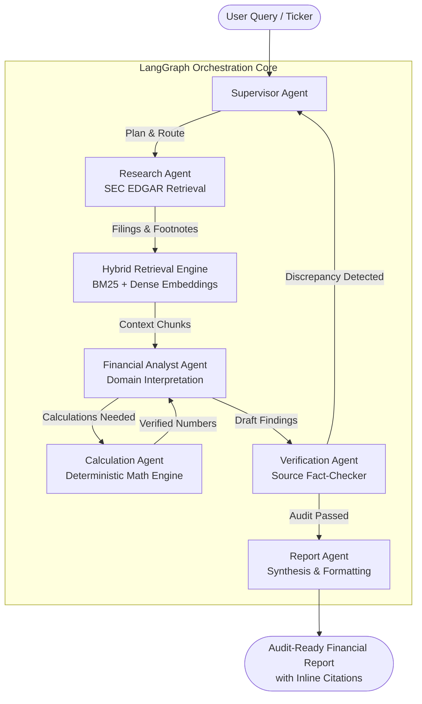
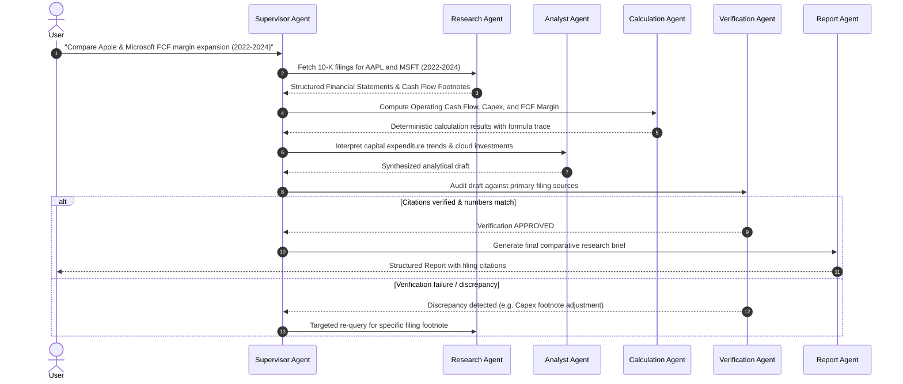

# Finova AI — System Architecture Specification

## 1. Architectural Vision

Finova AI is a modular, multi-agent financial research and intelligence system engineered to extract, verify, analyze, and synthesize corporate financial disclosures from SEC EDGAR filings (e.g., Form 10-K and 10-Q).

The primary architectural challenge addressed by Finova AI is **eliminating financial hallucinations** in AI-generated research. By decomposing financial inquiry into deterministic retrieval, specialized analytical reasoning, isolated arithmetic computation, and rigorous cross-verification, Finova AI produces audit-ready financial intelligence backed by primary source citations.

---

## 2. Multi-Agent Topology & State Graph

Finova AI utilizes a **LangGraph state machine** coordinated by a central supervisor with bidirectional verification loops.

---

## 3. Agent Roster & Functional Responsibilities

| Agent Name | Architectural Role | Core Responsibilities | Execution Type |
| :--- | :--- | :--- | :--- |
| **Supervisor Agent** | Graph Coordinator | Deconstructs complex financial queries into analytical steps, maintains the shared state, routes tasks, and manages replanning if validation fails. | LLM (Reasoning) |
| **Research Agent** | SEC & Filing Specialist | Fetches company filings via SEC EDGAR API, normalizes XBRL data, extracts financial statements, and performs hybrid RAG searches over filing text/footnotes. | Tool-based + LLM |
| **Financial Analyst Agent** | Domain Analyst | Evaluates financial health, identifies trends, conducts DuPont analysis, assesses liquidity/solvency risks, and contextualizes management disclosures. | LLM (Financial Prompt) |
| **Calculation Agent** | Arithmetic Engine | Executes pure deterministic Python math (growth rates, margins, coverage ratios, WACC, DCF). **Never relies on LLMs for arithmetic.** | Deterministic Code |
| **Verification Agent** | Quality Auditor | Audits every assertion, table cell, and ratio in the draft output against the raw filing excerpt. Flags ungrounded statements or discrepancies. | Deterministic + LLM Guard |
| **Report Agent** | Synthesis Specialist | Compiles verified metrics, interpretations, and filing citations into structured Markdown/PDF research reports. | LLM (Formatting) |

---

## 4. End-to-End Processing Workflow

---

## 5. Subsystem Architecture

### 5.1 Data Ingestion & SEC EDGAR Integration (Planned: Session 02)
- **SEC EDGAR API Client**: Compliant rate-limited requests (< 10 requests/sec) using declared `User-Agent`.
- **XBRL & HTML Parsers**: Extraction of Consolidated Statements of Operations, Balance Sheets, and Cash Flows.
- **Local Cache**: Local SQLite/file caching to eliminate duplicate network calls and support offline development.

### 5.2 Hybrid Retrieval Engine (Planned: Session 03)
- **Document Chunking**: Section-aware hierarchical chunking respecting SEC filing Item boundaries (Item 1A Risk Factors, Item 7 MD&A, Item 8 Financial Statements).
- **BM25 Sparse Retrieval**: Exact keyword and financial metric code matching.
- **Dense Vector Retrieval**: Local CPU-compatible embeddings (e.g., `all-MiniLM-L6-v2` or `bge-small-en-v1.5`).
- **Reciprocal Rank Fusion (RRF)**: Merges sparse and dense search rankings for high-precision retrieval over numerical tables.

### 5.3 Deterministic Financial Engine (Planned: Session 04)
- Dedicated mathematical modules implementing standard financial formulas:
  - Profitability: Gross Margin, Operating Margin, Net Margin, ROE, ROIC.
  - Liquidity & Solvency: Current Ratio, Quick Ratio, Debt-to-Equity, Interest Coverage.
  - Cash Flow: Free Cash Flow (Operating Cash Flow - Capex), FCF Conversion Rate.
  - Multi-Year Dynamics: YoY Growth, CAGR (Compound Annual Growth Rate).
- Every calculation produces an execution receipt containing: input values, filing line-item identifiers, formula string, and final value.

### 5.4 Verification Protocol (Planned: Session 05)
- Every quantitative metric must cite an exact filing document, page, and table coordinate.
- The Verification Agent parses each claim and asserts:
  $$\text{Claimed Value} = \text{Source Coordinate Value} \pm \epsilon$$
- If a numerical assertion cannot be corroborated from the ground-truth filing excerpt, it is purged before report generation.

---

## 6. Implementation Status Matrix

| Component / Subsystem | Target Session | Status | Notes |
| :--- | :--- | :--- | :--- |
| **Directory & Package Scaffolding** | Session 01 | **IMPLEMENTED** | Modular layout with separated concerns. |
| **Central Settings (Pydantic)** | Session 01 | **IMPLEMENTED** | Environment-driven config, `.env.example`. |
| **Centralized Logging System** | Session 01 | **IMPLEMENTED** | Console + Rotating File logs in `logs/`. |
| **FastAPI Backend Core** | Session 01 | **IMPLEMENTED** | `/health`, `/api/v1/health`, Swagger docs. |
| **Streamlit Frontend Foundation** | Session 01 | **IMPLEMENTED** | Dark navy analytics theme, status indicator. |
| **Automated Test Suite** | Session 01 | **IMPLEMENTED** | Pytest unit and integration tests. |
| **SEC EDGAR Data Ingestion** | Session 02 | Planned | Rate limiter, CIK mapper, 10-K/10-Q parser. |
| **Document Processing & Chunking** | Session 03 | Planned | Item-based SEC filing chunker. |
| **Hybrid RAG (BM25 + Vector)** | Session 03 | Planned | Local CPU embedding pipeline. |
| **Deterministic Finance Engine** | Session 04 | Planned | Financial formula library & verification receipts. |
| **LangGraph Agent Orchestration** | Session 05 | Planned | 6-agent cooperative state machine. |
| **Verification & Anti-Hallucination** | Session 05 | Planned | Citation auditing and numerical reconciliation. |
| **Full Report Generation UI** | Session 06 | Planned | Interactive dashboards, PDF export. |

---

## 7. Resource & Hardware Budget

To ensure full reproducibility without specialized cloud services or GPU hardware:
- **Compute**: Pure CPU execution on 16 GB RAM (compatible with standard Windows machines).
- **Embeddings**: Lightweight ONNX/PyTorch models (memory footprint < 500 MB).
- **LLM Strategy**: Compatible with local quantized models (via Ollama) or standard API endpoints.
- **Storage**: Local SQLite database and local disk file caching. Zero cost.

