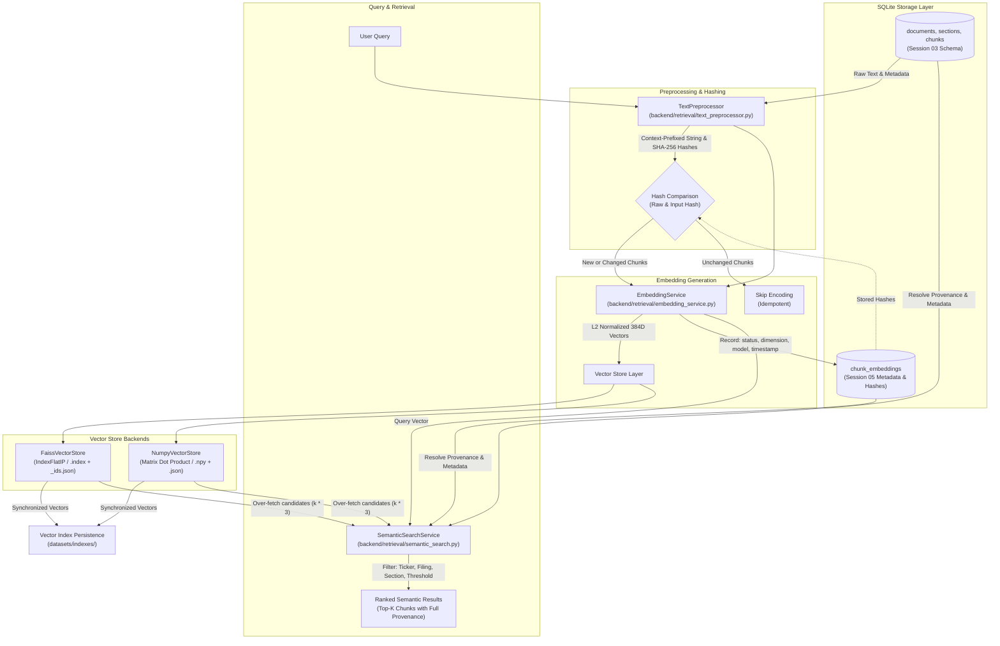

# Semantic Embeddings & Persistent Vector Indexing

Finova AI — Session 05 Retrieval Layer Architecture & Operational Guide

---

## 1. Executive Summary

Session 05 establishes the persistent dense retrieval foundation for **Finova AI — Multi-Agent Financial Research and Intelligence System**. Building directly upon the section-aware SEC filing chunks generated in Session 03, this layer converts narrative disclosures (Business, Risk Factors, MD&A, Market Risk) into dense semantic vector representations and persists them into high-performance vector indices.

The implementation operates strictly within CPU-only hardware constraints (16 GB RAM, Windows 11, zero-budget open-source stack) using `sentence-transformers` with the `all-MiniLM-L6-v2` model. It features content-hash-based incremental indexing, dual vector store backends (FAISS CPU and pure NumPy), SQLite metadata tracking, metadata-filtered dense search, and REST API/Streamlit interfaces.

---

## 2. Architecture Overview



---

## 3. Embedding Model Specifications

- **Model Name**: `sentence-transformers/all-MiniLM-L6-v2`
- **Output Embedding Dimension**: 384
- **Distance / Similarity Metric**: Cosine Similarity via Inner Product (`IP`) on $L_2$-normalized unit vectors:
  $$\cos(\theta) = \frac{\mathbf{u} \cdot \mathbf{v}}{\|\mathbf{u}\|_2 \|\mathbf{v}\|_2} = \mathbf{\hat{u}} \cdot \mathbf{\hat{v}}$$
- **Execution Device**: Local CPU (`torch.device("cpu")`), multi-threaded with batching (`batch_size=32`).
- **Lazy Initialization**: The deep neural network weights are never instantiated upon module import. Model loading is deferred until the first vector encoding invocation, keeping test suites, CLI tools, and non-retrieval endpoints fast and isolated.
- **Offline Dependency Injection**: `EmbeddingService` accepts an optional `encoder_fn` callable, allowing test suites to generate deterministic unit-norm vectors instantly without downloading weights or making outbound network calls.

---

## 4. Text Preprocessing & Provenance Prefixing

Financial SEC disclosures require careful text cleaning to avoid degrading numeric and tabular information:

### 4.1. Cleaning Rules
- **Preserved**: Numbers, decimals, percentages (`15.4%`), dollar amounts (`$1,200M`), dates (`September 30, 2023`), statutory item codes (`Item 1A`), and pipe-delimited table rows (`Cell 1 | Cell 2`).
- **Normalized**: Non-breaking spaces (`\xa0`) and zero-width spaces (`\u200b`, `\ufeff`) are replaced with standard spaces. Excessive horizontal whitespace and triple+ newlines are collapsed.
- **Header Stripping**: Redundant running page headers and pagination numbers (e.g. `Page 42`, `- 12 -`) are eliminated.

### 4.2. Context Prefixing
To ensure dense retrieval models capture company and section context accurately, text chunks are formatted before embedding:
```text
Company: {ticker} | Filing: {filing_type} | Section: {section_title} | Content: {cleaned_chunk_text}
```
*Example:*
```text
Company: AAPL | Filing: 10-K | Section: Item 1A. Risk Factors | Content: Global economic conditions and supply chain dependencies may adversely affect operations...
```

### 4.3. Cryptographic Hash Tracking
The preprocessor computes two separate SHA-256 hashes:
1. `raw_content_hash`: Hash of the raw un-prefixed chunk content.
2. `input_hash`: Hash of the context-prefixed text passed into the transformer model.

These hashes enable rapid change detection during incremental indexing.

---

## 5. Persistent Vector Store Architecture

Finova AI implements an abstract base class `BaseVectorStore` with two distinct backend engines:

### 5.1. FAISS CPU Backend (`FaissVectorStore`)
- **Index Type**: `faiss.IndexFlatIP` (Exact Inner Product / Cosine Similarity on normalized vectors).
- **Persistence Files**:
  - `datasets/indexes/{backend}_{dimension}.index`: Serialized binary FAISS index.
  - `datasets/indexes/{backend}_{dimension}_ids.json`: Ordered list of string vector IDs (`chunk_id`).
- **ID Mapping**: FAISS maintains zero-based sequential integer indices; `FaissVectorStore` maintains an in-memory bi-directional mapping between integer offsets and persistent string chunk IDs.
- **Vector Updates**: Updating a chunk vector utilizes FAISS ID reconstruction and selective replacement, rebuilding internally only when vector deletion is mandated.

### 5.2. NumPy Vector Store Backend (`NumpyVectorStore`)
- **Engine**: Pure Python and NumPy matrix multiplication (`matrix @ query_vector`).
- **Zero Heavy C-Dependency Fallback**: Fully functional even if FAISS binary wheels fail to compile or link on constrained operating systems.
- **Persistence Files**:
  - `datasets/indexes/{backend}_{dimension}_vectors.npy`: 2D float32 NumPy array.
  - `datasets/indexes/{backend}_{dimension}_ids.json`: List of string IDs.
- **Search**: Computes dot product across all matrix rows in vector registers, yielding exact cosine similarity identical to FAISS `IndexFlatIP`.

### 5.3. Factory Pattern
`get_vector_store(backend="auto", dimension=384, index_dir=None)`:
- When set to `"auto"`, automatically initializes `FaissVectorStore` if `faiss` is installed; falls back gracefully to `NumpyVectorStore` if unavailable.
- Configurable globally via `settings.EMBEDDING_BACKEND`.

---

## 6. Relational Persistence & State Tracking

Vector metadata and indexing state are tracked inside the SQLite database (`finova.db`) in table `chunk_embeddings`:

```sql
CREATE TABLE IF NOT EXISTS chunk_embeddings (
    embedding_id TEXT PRIMARY KEY,
    chunk_id TEXT NOT NULL,
    document_id TEXT NOT NULL,
    ticker TEXT NOT NULL,
    model_name TEXT NOT NULL,
    dimension INTEGER NOT NULL,
    vector_id TEXT NOT NULL,
    content_hash TEXT NOT NULL,
    input_hash TEXT NOT NULL,
    index_status TEXT NOT NULL DEFAULT 'indexed',
    created_at TIMESTAMP DEFAULT CURRENT_TIMESTAMP,
    updated_at TIMESTAMP DEFAULT CURRENT_TIMESTAMP,
    FOREIGN KEY (chunk_id) REFERENCES chunks(chunk_id) ON DELETE CASCADE,
    FOREIGN KEY (document_id) REFERENCES documents(document_id) ON DELETE CASCADE
);

CREATE INDEX IF NOT EXISTS idx_chunk_embeddings_ticker ON chunk_embeddings(ticker);
CREATE INDEX IF NOT EXISTS idx_chunk_embeddings_chunk ON chunk_embeddings(chunk_id);
CREATE INDEX IF NOT EXISTS idx_chunk_embeddings_model ON chunk_embeddings(model_name);
CREATE INDEX IF NOT EXISTS idx_chunk_embeddings_status ON chunk_embeddings(index_status);
```

### Hash-Based Change Detection
- **Skipped**: If `chunk_id` exists in `chunk_embeddings` with matching `input_hash` and `index_status == 'indexed'`, no GPU/CPU inference occurs.
- **Updated**: If `input_hash` changed (due to section re-extraction or metadata edit), the chunk is re-encoded, the vector is replaced in the vector store, and SQLite timestamps are refreshed.
- **Inserted**: If the chunk is newly ingested, it is batched, encoded, added to the vector index, and recorded in SQLite.
- **Forced**: Passing `force_reindex=True` bypasses hash checks and re-encodes all matching chunks.

---

## 7. Dense Semantic Search Workflow

```text
Query: "What supply chain risks does Apple face in Asia?"
  │
  ├── 1. TextPreprocessor.clean_text(query)
  ├── 2. EmbeddingService.encode_query(query) -> L2-normalized 384D float32 vector
  ├── 3. VectorStore.search(query_vec, top_k = k * 3) -> Top candidate vector IDs & scores
  ├── 4. DocumentStorage.get_chunk_with_provenance(chunk_id) -> Full chunk & filing metadata
  ├── 5. Filter Candidates:
  │      ├── ticker matches filter (e.g., AAPL)
  │      ├── filing_type matches filter (e.g., 10-K)
  │      ├── section_identifier matches filter (e.g., ITEM_1A)
  │      └── similarity_score >= similarity_threshold (default: 0.30)
  └── 6. Return Top-K SemanticSearchResult objects sorted by descending similarity score
```

---

## 8. REST API Reference

### 8.1. Trigger Incremental Indexing
`POST /api/v1/companies/{ticker}/embeddings/index`

**Request Body (JSON, Optional):**
```json
{
  "filing_type": "10-K",
  "accession_number": null,
  "force_reindex": false
}
```

**Response (`200 OK`):**
```json
{
  "ticker": "AAPL",
  "total_discovered": 48,
  "newly_indexed": 48,
  "updated_indexed": 0,
  "already_indexed": 0,
  "failed": 0,
  "model_name": "all-MiniLM-L6-v2",
  "backend": "faiss",
  "duration_seconds": 1.42,
  "message": "Successfully indexed 48 chunks for AAPL."
}
```

---

### 8.2. Check Embedding Status
`GET /api/v1/companies/{ticker}/embeddings/status`

**Response (`200 OK`):**
```json
{
  "ticker": "AAPL",
  "total_chunks": 48,
  "indexed_chunks": 48,
  "pending_chunks": 0,
  "failed_chunks": 0,
  "model_name": "all-MiniLM-L6-v2",
  "backend": "faiss",
  "last_indexed_at": "2026-11-15T20:10:00Z"
}
```

---

### 8.3. Dense Semantic Search
`POST /api/v1/search/semantic`

**Request Body (JSON):**
```json
{
  "query": "supply chain disruptions and semiconductor shortages",
  "ticker": "AAPL",
  "filing_type": "10-K",
  "section_identifier": "ITEM_1A",
  "top_k": 5,
  "similarity_threshold": 0.35
}
```

**Response (`200 OK`):**
```json
[
  {
    "chunk_id": "chunk_0000320193_10K_ITEM_1A_0002",
    "document_id": "doc_0000320193_0000320193-23-000106",
    "ticker": "AAPL",
    "filing_type": "10-K",
    "section_identifier": "ITEM_1A",
    "section_title": "Item 1A. Risk Factors",
    "content": "Substantially all of the Company's manufacturing is performed by outsourced partners located primarily in Asia...",
    "chunk_index": 2,
    "similarity_score": 0.8142,
    "accession_number": "0000320193-23-000106",
    "filing_date": "2023-10-27"
  }
]
```

---

### 8.4. Diagnostic Index Statistics
`GET /api/v1/index/stats`

**Response (`200 OK`):**
```json
{
  "backend": "faiss",
  "total_vectors": 128,
  "dimension": 384,
  "index_dir": "datasets/indexes",
  "is_empty": false,
  "indexed_tickers": ["AAPL", "MSFT", "NVDA"],
  "total_indexed_chunks": 128,
  "model_name": "all-MiniLM-L6-v2"
}
```

---

## 9. Streamlit User Interface

The Streamlit frontend (`frontend/app.py`) provides visual controls for embedding management and exploration:

1. **Company Filing Ingestion View (Tab 5 — "🔍 Semantic Search & Embeddings")**:
   - Displays real-time indexing status pills (`Indexed Chunks`, `Pending`, `Failed`).
   - "⚡ Generate / Update Vector Index" trigger button with optional `Force Re-index` checkbox.
   - Company-scoped interactive semantic query bar with top-k slider and threshold filter.
   - Expandable result cards displaying cosine similarity score, section tag, chunk ID, accession link, and highlighted text excerpt.

2. **Global Semantic Search View (Sidebar Navigation Option 3)**:
   - Cross-company semantic discovery across all indexed filers.
   - Vector Store Diagnostic Dashboard displaying active backend (`faiss` / `numpy`), vector dimensions, total index count, and indexed tickers.
   - Global query runner with multi-company and section dropdown filters.

---

## 10. Operational Guidelines & Testing Strategy

### 10.1. Running Unit & Integration Tests
All tests run 100% offline using mock encoders:
```powershell
.\.venv\Scripts\pytest.exe -k "retrieval or embeddings or vector" -v
```

### 10.2. Code Quality & Linting
Enforce formatting and Ruff rules:
```powershell
.\.venv\Scripts\ruff.exe check backend config tests frontend
.\.venv\Scripts\ruff.exe format backend config tests frontend
```

### 10.3. Index Reset / Rebuild Procedure
To wipe or rebuild indexes from scratch:
1. Delete index files in `datasets/indexes/`.
2. Clear SQLite `chunk_embeddings` table.
3. Call `IndexingService.rebuild_all_indexes()`.
