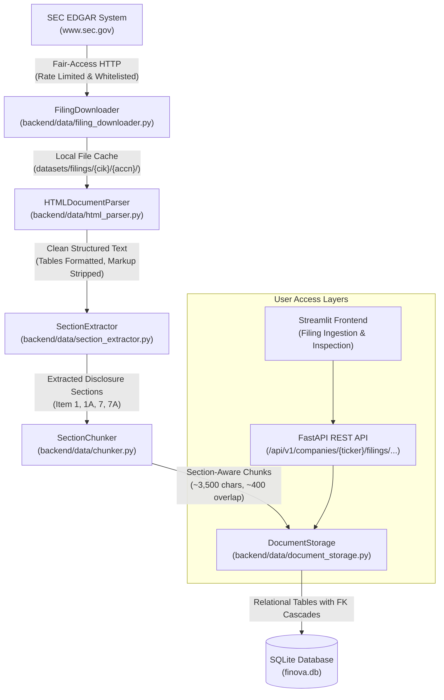

# SEC Filing Ingestion, HTML Processing & Section-Aware Chunking

Finova AI — Session 03 Document Processing Pipeline

---

## 1. Executive Summary

Session 03 extends Finova AI's capabilities from structured numerical XBRL data into statutory document ingestion and preprocessing. The system ingests primary HTML documents for SEC Forms 10-K (Annual Reports) and 10-Q (Quarterly Reports), strips non-content markup, unrolls inline XBRL structures, isolates key narrative disclosure sections (Business, Risk Factors, MD&A, Market Risk), and splits narrative text into deterministic, boundary-aware chunks with full provenance tracking.

---

## 2. Ingestion Pipeline Architecture



---

## 3. Pipeline Components & Responsibilities

### 3.1. Filing Downloader (`FilingDownloader`)
- **Domain Validation**: Restricts outbound downloads to sanctioned official SEC hosts (`ALLOWED_SEC_HOSTS = {"www.sec.gov", "data.sec.gov", "sec.gov"}`) to prevent arbitrary URL injection.
- **Fair-Access Rate Limiting**: Enforces a minimum delay (default: 0.12s) and max 10 requests/second policy per SEC regulations.
- **Exponential Backoff**: Traps transient HTTP 429 and 503 errors, applying jittered backoff before retrying.
- **Local Persistence & Caching**: Stores raw filing HTML under `datasets/filings/{cik}/{accession_number}/{primary_document}`. If cached and valid, returns cached file without hitting SEC servers unless `force_refresh=True`.
- **Integrity Hashing & Size Limits**: Verifies file size against `MAX_DOCUMENT_SIZE_BYTES` (default 50 MB) and calculates SHA-256 digest for auditability.

### 3.2. HTML & Inline XBRL Parser (`HTMLDocumentParser`)
- **Parser Engine**: Employs Python standard `BeautifulSoup` with `html.parser` for zero C-extension compile requirements.
- **Markup Stripping**: Eliminates scripts, style sheets, comments, noscript blocks, svgs, iframes, and elements explicitly marked as `hidden`, `aria-hidden="true"`, or `display: none`.
- **Inline XBRL Tag Unrolling**: Detects `<ix:nonNumeric>`, `<ix:nonFraction>`, and unrolls them to preserve inner numerical and text values smoothly while clearing XML namespace clutter.
- **Table Structure Preservation**: Formats tabular data into clean pipe-delimited text (`Cell 1 | Cell 2 | Cell 3`), preserving financial rows and alignments.
- **Whitespace Normalization**: Collapses repeated whitespaces, converts non-breaking spaces (`\xa0`) and zero-width spaces (`\u200b`), and standardizes double newlines between blocks.

### 3.3. Section Extractor (`SectionExtractor`)
Extracts canonical statutory disclosure items:
- **Item 1**: Business Description
- **Item 1A**: Risk Factors
- **Item 7**: Management's Discussion and Analysis of Financial Condition and Results of Operations (MD&A)
- **Item 7A**: Quantitative and Qualitative Disclosures About Market Risk

#### Form 10-K vs Form 10-Q Mapping
Form 10-Q reports structure their disclosures differently. The extractor canonicalizes them as follows:
| Canonical Identifier | Form 10-K Source Item | Form 10-Q Source Item |
|---|---|---|
| `ITEM_1` | Item 1 (Business) | N/A (Annual only) |
| `ITEM_1A` | Item 1A (Risk Factors) | Part II Item 1A (Risk Factors) |
| `ITEM_7` | Item 7 (MD&A) | Part I Item 2 (MD&A) |
| `ITEM_7A` | Item 7A (Market Risk) | Part I Item 3 (Market Risk) |

#### Table of Contents (TOC) Traps & Heuristic Rejection
In statutory SEC filings, Table of Contents tables reference all item titles in close proximity. A naive regex match will falsely capture the TOC table as substantive text.
Finova AI eliminates TOC false-positives by:
1. Finding all candidate starting positions matching the section heading.
2. Finding the next item end boundary.
3. Calculating candidate character length: TOC listings are tightly clustered (typically < 100 characters to the next item).
4. Enforcing `min_section_chars` (default: 150 characters). The extractor skips short TOC entries and advances to the substantive body section.

### 3.4. Section-Aware Chunker (`SectionChunker`)
- **Target Size & Overlap**: Default ~3,500 characters per chunk with ~400 character overlap.
- **Natural Boundary Snapping**: Rather than cutting mid-sentence or mid-word, the chunker scans the trailing window to prioritize:
  1. Paragraph boundaries (`\n\n`)
  2. Sentence terminators (`. `, `! `, `? `)
  3. Word boundaries (spaces)
- **Deterministic Numbering**: Sequentially indexes chunks (`chunk_index = 0, 1, 2, ...`).
- **Complete Provenance Preservation**: Every chunk carries:
  - `company_ticker`, `company_cik`, `company_name`
  - `accession_number`, `filing_type`, `filing_date`, `report_date`
  - `section_identifier`, `section_title`
  - `start_offset`, `end_offset`, `char_count`
  - `source_url`

---

## 4. Relational Database Schema

The pipeline uses three relational tables with cascading foreign keys:

```sql
-- 1. Ingested Documents
CREATE TABLE IF NOT EXISTS documents (
    document_id TEXT PRIMARY KEY,
    cik TEXT NOT NULL,
    ticker TEXT NOT NULL,
    company_name TEXT NOT NULL,
    accession_number TEXT UNIQUE NOT NULL,
    filing_type TEXT NOT NULL,
    filing_date TEXT NOT NULL,
    report_date TEXT,
    primary_document TEXT NOT NULL,
    source_url TEXT NOT NULL,
    local_file_path TEXT NOT NULL,
    processing_status TEXT NOT NULL,
    document_hash TEXT NOT NULL,
    error_message TEXT,
    created_at TEXT NOT NULL,
    updated_at TEXT NOT NULL,
    FOREIGN KEY (cik) REFERENCES companies (cik) ON DELETE CASCADE
);

-- 2. Document Sections
CREATE TABLE IF NOT EXISTS document_sections (
    section_id TEXT PRIMARY KEY,
    document_id TEXT NOT NULL,
    section_identifier TEXT NOT NULL,
    section_title TEXT NOT NULL,
    extraction_status TEXT NOT NULL,
    char_count INTEGER NOT NULL DEFAULT 0,
    start_char INTEGER DEFAULT -1,
    end_char INTEGER DEFAULT -1,
    extracted_text TEXT NOT NULL DEFAULT '',
    created_at TEXT NOT NULL,
    FOREIGN KEY (document_id) REFERENCES documents (document_id) ON DELETE CASCADE,
    UNIQUE(document_id, section_identifier)
);

-- 3. Document Chunks
CREATE TABLE IF NOT EXISTS document_chunks (
    chunk_id TEXT PRIMARY KEY,
    document_id TEXT NOT NULL,
    section_id TEXT NOT NULL,
    ticker TEXT NOT NULL,
    accession_number TEXT NOT NULL,
    filing_type TEXT NOT NULL,
    section_identifier TEXT NOT NULL,
    section_title TEXT NOT NULL,
    chunk_index INTEGER NOT NULL,
    chunk_text TEXT NOT NULL,
    start_offset INTEGER NOT NULL,
    end_offset INTEGER NOT NULL,
    char_count INTEGER NOT NULL,
    source_url TEXT NOT NULL,
    created_at TEXT NOT NULL,
    FOREIGN KEY (document_id) REFERENCES documents (document_id) ON DELETE CASCADE,
    FOREIGN KEY (section_id) REFERENCES document_sections (section_id) ON DELETE CASCADE,
    UNIQUE(document_id, section_identifier, chunk_index)
);
```

---

## 5. REST API Endpoints

| Method | Endpoint | Description |
|---|---|---|
| `POST` | `/api/v1/companies/{ticker}/filings/{accession}/ingest` | Triggers download, parsing, section extraction, and chunking. Supports `?force_refresh=true`. |
| `GET` | `/api/v1/companies/{ticker}/documents` | Lists all ingested documents for a company, with optional `?filing_type=10-K` filter. |
| `GET` | `/api/v1/companies/{ticker}/documents/{accession}` | Retrieves metadata, extracted section summary, and total chunk count for an ingested filing. |
| `GET` | `/api/v1/companies/{ticker}/documents/{accession}/chunks` | Retrieves section-aware text chunks with full provenance and optional `?section_identifier=ITEM_1A` filtering. |

---

## 6. Constraints, Limitations & Future RAG Interface

1. **Scope Boundaries**: Session 03 focuses strictly on ingestion, HTML cleaning, section isolation, chunking, and SQLite persistence. No vector databases (FAISS/ChromaDB), embedding models, BM25 indices, or LLM interactions are included.
2. **Exhibits & External Attachments**: Only primary filing HTML documents are parsed; external exhibits (e.g., Exhibit 21 subsidiary lists) are excluded.
3. **Filing Form Coverage**: Supported forms are Form 10-K and Form 10-Q. Forms 8-K, 20-F, and S-1 are planned for subsequent milestones.
4. **Readiness for Session 04 & RAG**: Stored chunks carry explicit character coordinates, section identifiers, and SEC archive URLs, providing the foundation for embedding generation, hybrid retrieval, and citation verification in later sessions.
