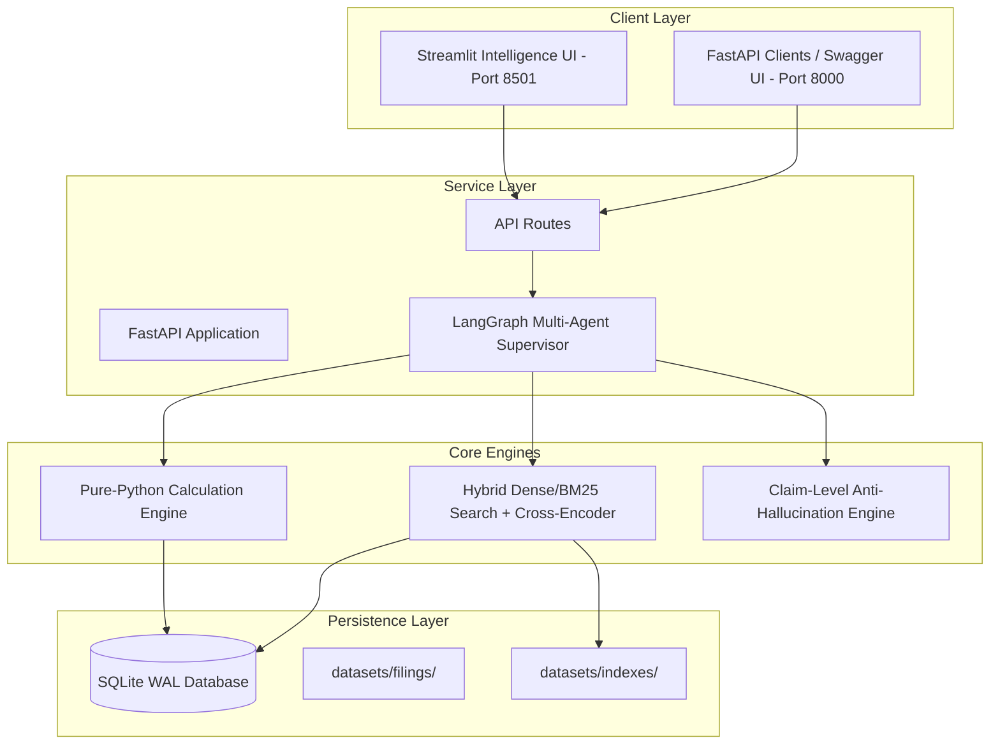

# Finova AI — Final System Validation, Deployment & Launch Guide

## 1. System Architecture Overview

**Finova AI** is a multi-agent financial intelligence and research platform engineered to synthesize corporate financial analysis backed by statutory SEC Form 10-K filings.



---

## 2. Clean Installation Validation

### Prerequisites
- **Operating System:** Windows 11, Windows 10, macOS, or Linux
- **Python Version:** Python 3.11+
- **Hardware Requirement:** 16 GB RAM recommended, standard CPU (no dedicated GPU required)
- **Disk Space:** ~2 GB for dependencies, indexes, and filing storage

### Step-by-Step Clean Setup
```bash
# 1. Clone repository
git clone https://github.com/varshakm17/finova-ai.git
cd finova-ai

# 2. Create isolated virtual environment
python -m venv .venv

# 3. Activate virtual environment
# Windows (PowerShell):
.\.venv\Scripts\Activate.ps1
# Linux / macOS:
source .venv/bin/activate

# 4. Install dependencies
pip install --upgrade pip
pip install -r requirements.txt
pip install -r requirements-dev.txt

# 5. Configure environment file
copy .env.example .env
```

### Initial State Behavior
The system initializes gracefully from a completely empty state:
- No pre-populated database is required: SQLite schema tables are created automatically on application launch.
- No pre-downloaded filings or vector indexes are required: missing indexes trigger informative fallback messages rather than unhandled crashes.
- Local LLM execution is completely optional: deterministic financial analysis and rule-based verification run without Ollama.

---

## 3. Windows Local Run Guide

### Starting the FastAPI Backend
```powershell
.\.venv\Scripts\Activate.ps1
uvicorn backend.main:app --host 127.0.0.1 --port 8000 --reload
```
- **Backend URL:** `http://127.0.0.1:8000`
- **Swagger Documentation:** `http://127.0.0.1:8000/docs`
- **Health Check Endpoint:** `http://127.0.0.1:8000/api/v1/health`

### Starting the Streamlit Frontend
In a separate terminal:
```powershell
.\.venv\Scripts\Activate.ps1
streamlit run frontend/app.py --server.port 8501
```
- **Streamlit URL:** `http://localhost:8501`

### Optional Ollama Setup (Local LLM)
If generative synthesis with local LLM is desired:
```powershell
# 1. Install Ollama from https://ollama.com
# 2. Pull compact 3B model (CPU compatible)
ollama pull qwen2.5:3b

# 3. Verify Ollama is running
curl http://localhost:11434/api/tags
```
If Ollama is not running, Finova AI automatically falls back to deterministic extraction and rules-based reporting.

---

## 4. Docker Deployment Validation

Finova AI includes multi-stage production Docker configurations:
- `Dockerfile.backend`: FastAPI + SQLite + CPU ML inference.
- `Dockerfile.frontend`: Streamlit intelligence UI.
- `docker-compose.yml`: Multi-service orchestration with persistent volume mounts and container healthchecks.

### Running with Docker Compose
```bash
# Build and start services in background
docker compose up -d --build

# View container logs
docker compose logs -f

# Verify service health
docker compose ps
```

### Host-Gateway Configuration for External Ollama
Inside Docker containers, `localhost` refers to the container itself. To connect to an Ollama instance running on the host machine, `docker-compose.yml` configures:
```yaml
environment:
  - OLLAMA_BASE_URL=http://host.docker.internal:11434
extra_hosts:
  - "host.docker.internal:host-gateway"
```

### Persistent Data Volumes
- `finova_data`: Stores `finova.db` SQLite database.
- `finova_filings`: Stores downloaded SEC Form 10-K HTML documents.
- `finova_logs`: Stores runtime operational logs.
- `./reports`: Mounted from host to store generated executive briefs.

---

## 5. End-to-End Demonstrations & Audits

### Executing Real Company Demonstrations
Run the reproducible demonstration suite covering Apple (AAPL), Microsoft (MSFT), Tesla (TSLA), and NVIDIA (NVDA):
```powershell
python -m evaluation.demo_scenarios.demo_scenarios --scenario all
```
Generated reports are exported to `reports/demos/`:
- `aapl_fy2022-fy2023_demo_brief.md` / `.html`
- `msft_fy2022-fy2023_demo_brief.md` / `.html`
- `tsla_fy2022-fy2023_demo_brief.md` / `.html`
- `nvda_fy2023-fy2024_demo_brief.md` / `.html`

### Running the Demo Integrity Auditor
```powershell
python -m evaluation.demo_scenarios.demo_integrity_auditor
```
Validates that:
- Every `[E#]` citation maps to an authentic SEC EDGAR filing passage.
- Every `[C#]` reference maps to a deterministic calculation receipt.
- All accession numbers and CIK codes match official SEC records.
- All 4 company briefs achieve 100% verified integrity status.

---

## 6. Real SEC Benchmark & IR Evaluation

### Running Real-World SEC Benchmark Certification
```powershell
python -m evaluation.real_sec_benchmark_validator
```
Audits all 24 benchmark queries across AAPL, MSFT, TSLA, and NVDA (20 certified ground truth + 4 pending annotations).

### Executing Unified Evaluation Suite
```powershell
# Run real SEC filing retrieval evaluation
python -m evaluation.run_evaluation --eval-type retrieval --dataset real_sec

# Run financial calculation benchmark
python -m evaluation.run_evaluation --eval-type calculation

# Run system integration pipeline benchmark
python -m evaluation.run_evaluation --eval-type integration

# Run comprehensive benchmark across all suites
python -m evaluation.run_evaluation --eval-type all
```

---

## 7. Testing Suite Execution

### 100% Offline Test Suite (Default)
Normal test runs require zero internet connectivity and zero running external services:
```powershell
pytest
```
**Current Test Results:** **405 passed, 12 skipped in ~108s (100% offline pass rate)**.

### Optional Live SEC Integration Tests
Live tests make legitimate HTTP requests to SEC EDGAR servers with compliant User-Agent headers:
```powershell
pytest --run-live-sec
```

---

## 8. Security & Performance Observations

### Security Hardening Audit
Run the automated security auditor:
```powershell
python -m evaluation.security_audit
```
- **SQL Injection:** 100% of SQLite database queries use parameterized `?` bindings.
- **Secrets Management:** Zero hardcoded API keys or credentials; secrets are isolated in `.env` and git-ignored.
- **Path Traversal Protection:** Filing storage strictly resolves paths against application boundaries.
- **SEC Fair Access:** User-Agent format headers and request throttling are enforced.

### Performance Smoke Tests
Run baseline system performance benchmarks:
```powershell
python -m evaluation.performance_smoke_tests
```
**Empirical Measurements (Windows 11, Intel 12-core, 16 GB RAM, CPU):**
- Backend Application Startup: ~1.65 s
- Subsystem Health Diagnostics Endpoint: 11.0 ms (P95: 50.3 ms)
- Company Directory Lookup: < 0.01 ms
- Deterministic Ratio Calculation: < 0.01 ms
- Dual Markdown & HTML Report Synthesis: 0.03 ms
- SQLite Transactional Upsert & Read: 0.94 ms

---

## 9. Troubleshooting & FAQ

| Symptom | Probable Cause | Recommended Resolution |
| :--- | :--- | :--- |
| `ModuleNotFoundError: No module named 'bs4'` | System Python invoked instead of venv | Ensure virtual environment is activated (`.\.venv\Scripts\Activate.ps1`). |
| `SECConfigurationError: SEC_USER_AGENT not configured` | Missing or default user agent in `.env` | Set `SEC_USER_AGENT=YourName ContactEmail@domain.com` in `.env`. |
| `FastAPI Backend Offline` banner in Streamlit | Backend server is not running on port 8000 | Start backend via `uvicorn backend.main:app --port 8000`. |
| `Docker command not recognized` | Docker Desktop is not installed on Windows host | Install Docker Desktop for Windows or run directly with Python virtual environment. |
| `Ollama connection refused` | Ollama service not running | Start Ollama via `ollama serve` or run in fallback deterministic mode. |

---

## 10. Known Limitations

1. **Non-GAAP Reconciliations:** Non-GAAP metrics adjusted by company management (e.g., Adjusted EBITDA) are reported as narrative disclosures rather than pure XBRL facts.
2. **Foreign Private Issuers (Form 20-F):** Initial parsing focuses on US domestic issuers filing statutory Form 10-K and 10-Q under US GAAP taxonomy.
3. **CPU Inference Latency for Large Contexts:** Generating multi-page drafts with a local 3B LLM on CPU takes approximately 10–25 seconds per section; deterministic mode runs in under 300 ms.

