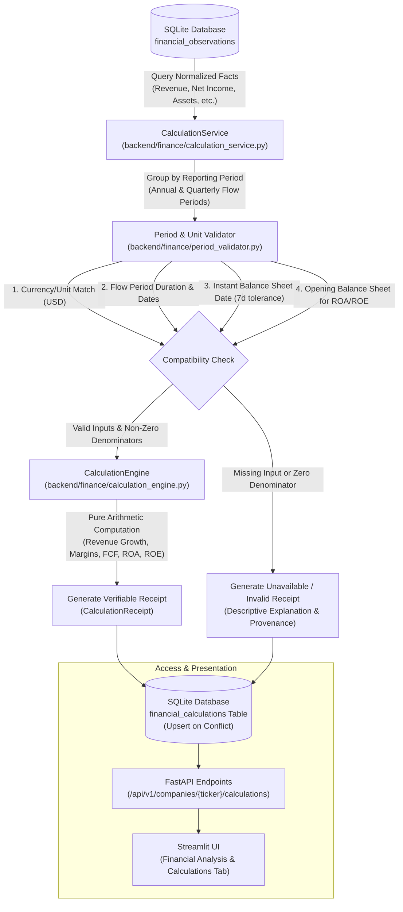

# Deterministic Financial Calculation Engine & Financial Analysis API

Finova AI — Session 04 Financial Calculation Layer

---

## 1. Executive Summary

Session 04 introduces a pure Python, deterministic financial calculation engine for **Finova AI**. Built upon the normalized SEC XBRL observations stored during Session 02, the calculation engine computes key corporate performance indicators without relying on Large Language Models (LLMs) for arithmetic, formula evaluation, or numerical derivation.

Every calculation produces an auditable, verifiable **Calculation Receipt** that records:
- The exact mathematical formula expression.
- The precise input observations used (reported values, original tags, accession numbers, SEC source URLs).
- Applied transformations and sign normalizations (e.g. CapEx sign adjustment).
- Status classification (`calculated`, `unavailable`, `invalid_inputs`) with descriptive reasoning when data is missing or incompatible.

Calculations are persisted in a dedicated SQLite relational table (`financial_calculations`), exposed via 4 FastAPI endpoints, and visualized through an interactive Streamlit workspace with summary scorecards, tabular displays, and transparent calculation receipts.

---

## 2. Calculation Pipeline Architecture



---

## 3. Supported Financial Formulas

The calculation engine deterministically computes 10 core financial metrics plus an explicit fallback metric:

| Metric Key | Metric Name | Standard Formula | Unit | Required Input Observations |
|---|---|---|---|---|
| `revenue_growth` | Revenue Growth | `((Current Revenue - Previous Revenue) / Previous Revenue) * 100` | `%` | Current Revenue, Prior Year Revenue |
| `gross_profit_margin` | Gross Profit Margin | `(Gross Profit / Revenue) * 100` | `%` | Gross Profit, Revenue |
| `operating_profit_margin` | Operating Profit Margin | `(Operating Income / Revenue) * 100` | `%` | Operating Income, Revenue |
| `net_profit_margin` | Net Profit Margin | `(Net Income / Revenue) * 100` | `%` | Net Income, Revenue |
| `current_ratio` | Current Ratio | `Current Assets / Current Liabilities` | `ratio` | Current Assets, Current Liabilities |
| `debt_to_equity_ratio` | Debt-to-Equity Ratio | `Total Debt / Stockholders' Equity` | `ratio` | Total Debt, Stockholders' Equity |
| `long_term_debt_to_equity` | Long-Term Debt to Equity | `Long-Term Debt / Stockholders' Equity` | `ratio` | Long-Term Debt, Stockholders' Equity |
| `return_on_assets` | Return on Assets (ROA) | `(Net Income / Average Total Assets) * 100` | `%` | Net Income, Ending Assets, Opening Assets |
| `return_on_equity` | Return on Equity (ROE) | `(Net Income / Average Stockholders' Equity) * 100` | `%` | Net Income, Ending Equity, Opening Equity |
| `operating_cash_flow_margin` | Operating Cash Flow Margin | `(Operating Cash Flow / Revenue) * 100` | `%` | Operating Cash Flow, Revenue |
| `free_cash_flow` | Free Cash Flow (FCF) | `Operating Cash Flow - Normalized CapEx` | `USD` | Operating Cash Flow, Capital Expenditures |

### Total Debt vs Long-Term Debt Handling
In statutory US-GAAP filings, companies universally report `us-gaap:LongTermDebtNoncurrent` but rarely report a single aggregated `Total Debt` line item. To prevent incorrect substitution:
1. `debt_to_equity_ratio` strictly checks for a statutory `Total Debt` observation. If absent, it returns status `unavailable` with a clear explanation:
   > *"Total Debt observation is not reported in statutory XBRL facts. Use long_term_debt_to_equity for available Long-Term Debt."*
2. `long_term_debt_to_equity` calculates `Long-Term Debt / Stockholders' Equity`, making the numerator explicit and transparent.

### Capital Expenditures Sign Normalization
In SEC cash flow statements, Capital Expenditures (`PaymentsToAcquirePropertyPlantAndEquipment` or `PaymentsToAcquireProductiveAssets`) are reported inconsistently—some filers report them as positive outflows (e.g. `10,959,000,000`), while others report them as negative cash reductions (e.g. `-10,959,000,000`).

The calculation engine normalizes CapEx to a positive outflow:
$$\text{CapEx}_{\text{normalized}} = |\text{CapEx}_{\text{reported}}|$$
$$\text{Free Cash Flow} = \text{Operating Cash Flow} - \text{CapEx}_{\text{normalized}}$$

Whenever a negative CapEx value is encountered, the engine records an audit warning:
> *"Reported CapEx (-10959000000.0 USD) was negative; normalized to positive outflow magnitude (10959000000.0 USD) before subtraction."*

---

## 4. Input Validation & Period Alignment

Before any formula is executed, the `period_validator` module enforces strict accounting alignment:

### 4.1. Unit Compatibility
Observations combined in a single formula must share identical currency units (default `USD`):
- Observations with different units (e.g., `USD` vs `shares` or `EUR`) are rejected immediately with `invalid_inputs`.
- Shares or non-monetary metrics cannot be combined with currency values.

### 4.2. Flow-to-Flow Period Alignment
For income statement and cash flow ratios (e.g. Gross Margin, OPM, NPM, Cash Flow Margin):
- Both numerator and denominator must have identical `period_type` (`annual` with `annual`, `quarterly` with `quarterly`).
- Both must share the same `period_end` date.
- Cumulative Year-To-Date (`ytd`) observations are rejected from quarterly margin calculations to prevent distorting 3-month performance with 6-month or 9-month aggregates.

### 4.3. Instant Balance Sheet Alignment (Floating Fiscal Year Tolerance)
Balance sheet metrics (`Current Assets`, `Total Assets`, `Current Liabilities`, `Stockholders' Equity`) represent instantaneous points in time (`period_type="instant"`).
- Many US corporations (e.g. Apple, Microsoft, Target) use floating 52/53-week fiscal calendars ending on the last Saturday of September or closest Friday.
- A $\pm 7$-day calendar tolerance is permitted when matching closing balance sheet dates to income statement flow period ends.
- Points exceeding 7 days are rejected to prevent comparing misaligned fiscal quarters.

### 4.4. Average Balance Sheet Bracketing (ROA and ROE)
Return on Assets and Return on Equity represent flow returns earned over a duration using the balance sheet capital available throughout that period:
$$\text{Average Assets} = \frac{\text{Assets}_{\text{opening}} + \text{Assets}_{\text{closing}}}{2}$$
$$\text{Average Equity} = \frac{\text{Equity}_{\text{opening}} + \text{Equity}_{\text{closing}}}{2}$$

- **Closing Balance Sheet**: Instant observation matching the income statement `period_end` (within 7-day tolerance).
- **Opening Balance Sheet**: Instant observation matching the income statement `period_start` (or prior fiscal year closing date within 14-day tolerance).
- **Integrity Guarantee**: If an opening balance sheet observation cannot be located (e.g. for the earliest reported year), the engine marks the metric `unavailable` with reason:
  > *"Opening balance sheet observation for Total Assets at period start 2021-09-26 is missing. Cannot calculate average balance sheet denominator."*
  The engine never assumes closing assets equal average assets, preserving data integrity.

### 4.5. Zero Denominator Protection
All division operations are guarded:
- If a denominator equals zero (e.g. Revenue = 0 or Equity = 0), the engine marks the status `invalid_inputs` with reason:
  > *"Zero denominator encountered: Revenue is 0.0."*

---

## 5. Traceable Calculation Receipts (`CalculationReceipt`)

Every calculation—whether successful, unavailable, or invalid—yields a deterministic JSON receipt conforming to the `CalculationReceipt` schema:

```json
{
  "calculation_id": "0000320193_gross_profit_margin_annual_2023-09-30",
  "ticker": "AAPL",
  "cik": "0000320193",
  "company_name": "Apple Inc.",
  "metric_name": "gross_profit_margin",
  "calculated_value": 44.1311,
  "unit": "percentage",
  "period_type": "annual",
  "period_start": "2022-09-25",
  "period_end": "2023-09-30",
  "fiscal_year": 2023,
  "fiscal_period": "FY",
  "formula_name": "Gross Profit Margin",
  "formula_expression": "(Gross Profit / Revenue) * 100",
  "status": "calculated",
  "unavailable_reason": null,
  "inputs": [
    {
      "metric_name": "Gross Profit",
      "reported_value": 169148000000.0,
      "unit": "USD",
      "period_start": "2022-09-25",
      "period_end": "2023-09-30",
      "statement_type": "Income Statement",
      "original_tag": "us-gaap:GrossProfit",
      "accession_number": "0000320193-23-000106",
      "source_url": "https://www.sec.gov/Archives/edgar/data/0000320193/000032019323000106"
    },
    {
      "metric_name": "Revenue",
      "reported_value": 383285000000.0,
      "unit": "USD",
      "period_start": "2022-09-25",
      "period_end": "2023-09-30",
      "statement_type": "Income Statement",
      "original_tag": "us-gaap:Revenues",
      "accession_number": "0000320193-23-000106",
      "source_url": "https://www.sec.gov/Archives/edgar/data/0000320193/000032019323000106"
    }
  ],
  "warnings": [],
  "calculated_at": "2026-11-15T19:28:44.123456Z"
}
```

---

## 6. Database Storage & Persistence

Calculated metrics are stored in a dedicated SQLite table (`financial_calculations`) separate from raw reported observations:

```sql
CREATE TABLE IF NOT EXISTS financial_calculations (
    id INTEGER PRIMARY KEY AUTOINCREMENT,
    calculation_id TEXT UNIQUE NOT NULL,
    cik TEXT NOT NULL,
    ticker TEXT NOT NULL,
    company_name TEXT NOT NULL,
    metric_name TEXT NOT NULL,
    calculated_value REAL,
    unit TEXT NOT NULL,
    period_type TEXT NOT NULL,
    period_start TEXT,
    period_end TEXT NOT NULL,
    fiscal_year INTEGER,
    fiscal_period TEXT,
    formula_name TEXT NOT NULL,
    formula_expression TEXT NOT NULL,
    calculation_status TEXT NOT NULL,
    unavailable_reason TEXT,
    input_observations_json TEXT NOT NULL,
    warnings_json TEXT NOT NULL,
    created_at TIMESTAMP DEFAULT CURRENT_TIMESTAMP,
    FOREIGN KEY (cik) REFERENCES companies (cik) ON DELETE CASCADE,
    UNIQUE(cik, metric_name, period_end, period_type, period_start)
);
```

### Key Schema Characteristics
- **Separation of Concerns**: Raw reported SEC observations in `financial_observations` remain completely immutable. Derived values live strictly in `financial_calculations`.
- **Compound Unique Constraint**: `UNIQUE(cik, metric_name, period_end, period_type, period_start)` prevents duplicate entries across runs.
- **Idempotent Recalculations**: Uses SQLite `INSERT INTO ... ON CONFLICT DO UPDATE SET` to cleanly update recalculated values without errors.
- **Auditable Input Serialization**: Input observations and warnings are persisted as serialized JSON arrays directly in the database row.

---

## 7. REST API Endpoints

The backend exposes four dedicated calculation endpoints:

### 7.1. Trigger Financial Calculations
- **Endpoint**: `POST /api/v1/companies/{ticker}/calculations`
- **Query / Body Parameters**:
  - `start_year` (optional): Earliest fiscal year to compute (inclusive).
  - `end_year` (optional): Latest fiscal year to compute (inclusive).
  - `period_type` (optional): `'annual'` (default) or `'quarterly'`.
  - `metrics` (optional): List of specific metric keys to compute.
- **Response**: `CalculationSummaryResponse` detailing counts and list of receipts.

```bash
curl -X POST "http://127.0.0.1:8000/api/v1/companies/AAPL/calculations?period_type=annual" \
     -H "Content-Type: application/json"
```

### 7.2. List Stored Calculations
- **Endpoint**: `GET /api/v1/companies/{ticker}/calculations`
- **Query Parameters**:
  - `metric_name` (optional): Filter by metric key.
  - `start_year` / `end_year` (optional): Fiscal year range.
  - `period_type` (optional): `'annual'` or `'quarterly'`.
- **Response**: List of `CalculationReceipt` objects.

### 7.3. Get Metric History
- **Endpoint**: `GET /api/v1/companies/{ticker}/calculations/{metric_name}`
- **Query Parameters**:
  - `period_type` (optional): `'annual'` or `'quarterly'`.
- **Response**: Chronological list of calculation receipts for the requested metric.

### 7.4. Get Calculation Receipt by ID
- **Endpoint**: `GET /api/v1/calculations/{calculation_id}`
- **Response**: Single complete `CalculationReceipt` with full input provenance.

---

## 8. Streamlit Financial Analysis Workspace

An interactive workspace is provided in Tab 4 (**🧮 Financial Analysis & Calculations**) of the Streamlit dashboard:

1. **Scope Controls**:
   - Radio toggle between Annual (`10-K`) and Quarterly (`10-Q`) scopes.
   - Fiscal year range sliders.
   - Multiselect metric filter allowing users to calculate all or specific metrics.
2. **Execute Calculations Button**:
   - Triggers the calculation engine via the backend API.
   - Refreshes cached metrics and displays progress feedback.
3. **Executive Summary Scorecards**:
   - Total Metrics Calculated.
   - Unavailable Metrics (with reasons).
   - Invalid Inputs count.
4. **Interactive Calculated Results Table**:
   - Displays Metric Name, Fiscal Year, Period Type, Period End Date, and Formatted Value.
5. **Verifiable Calculation Receipts**:
   - Expandable inspect cards for each calculated metric.
   - Displays exact mathematical formula.
   - Shows reported input observations, original SEC XBRL tags, filing dates, accession numbers, and clickable SEC Archive URLs.
   - Displays CapEx normalization warnings when applicable.

---

## 9. Verification & Code Quality

- **Test Suite**: 116 unit and integration tests passing offline with synthetic fixtures.
- **Coverage**:
  - `backend/finance/calculation_engine.py`: **100%**
  - `backend/finance/calculation_models.py`: **100%**
  - `backend/finance/period_validator.py`: **100%**
  - `backend/finance/calculation_service.py`: **92%**
  - Project Overall Coverage: **89%**
- **Code Quality**: 100% compliant with Ruff linting and formatting.
- **Pure Arithmetic Guarantee**: All calculations execute via native Python floating-point operations. Zero LLM involvement in arithmetic or formula selection.
