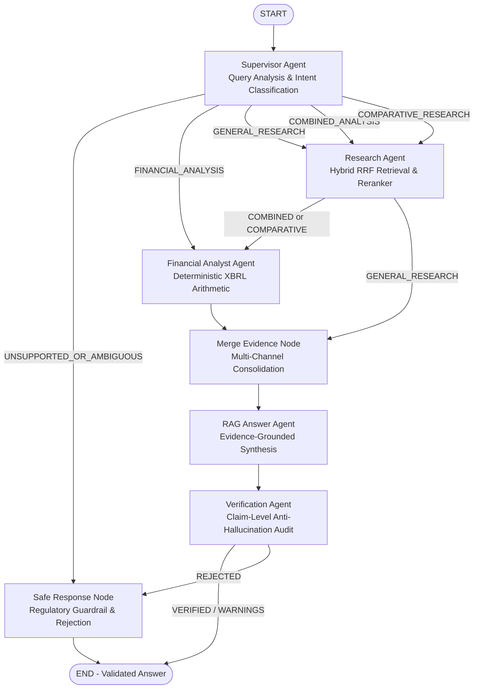

# LangGraph Multi-Agent Orchestration Architecture

Finova AI employs a compiled state graph orchestrator powered by **LangGraph** (`v1.2.22` / `v0.2.x+`) to coordinate specialized, domain-specific AI agents. The multi-agent workflow processes complex corporate finance questions, guarantees deterministic arithmetic computation, enforces statutory citation grounding, and validates all output claims before presentation.

---

## 1. High-Level Architecture & Workflow Graph

The Finova multi-agent orchestration graph connects six specialized nodes through typed state transitions and conditional routing edges.



---

## 2. Intent Classification & Routing Taxonomy

The **Supervisor Agent** classifies incoming user inquiries into five discrete intents, extracts statutory entities (tickers and reporting periods), and determines the workflow topology:

| Intent Identifier | Workflow Topology | Selected Agents | Typical Query Examples |
|---|---|---|---|
| `GENERAL_RESEARCH` | `research_only` | Research, RAG, Verification | "What are Apple's primary risk factors in MD&A?", "Explain Tesla's legal proceedings." |
| `FINANCIAL_ANALYSIS` | `financial_only` | Financial Analyst, RAG, Verification | "What is Apple's gross profit margin and debt-to-equity ratio in FY2023?" |
| `COMBINED_ANALYSIS` | `combined_analysis` | Research, Financial Analyst, RAG, Verification | "Analyze Apple's business strategy and explain its gross margin trend in FY2023." |
| `COMPARATIVE_RESEARCH` | `comparative_analysis` | Research, Financial Analyst, RAG, Verification | "Compare operating profit margins and competitive strategy between Apple and Microsoft." |
| `UNSUPPORTED_OR_AMBIGUOUS` | `safe_rejection` | Safe Response Guardrail | "Should I buy Tesla stock?", "Predict Apple share price tomorrow", "hello" |

### Entity Extraction
- **Company Ticker**: Resolves stock symbols (`AAPL`, `MSFT`, `NVDA`, `TSLA`, `GOOGL`) and common company names using regex and dictionary normalization while filtering accounting acronym stopwords (`GAAP`, `IFRS`, `SEC`, `EBITDA`, `MD&A`).
- **Reporting Period**: Extracts canonical fiscal periods (e.g. `FY2023`, `2023`, `Q3 2022`).

---

## 3. Shared State Schema (`FinovaAgentState`)

All nodes read and modify a strongly-typed `TypedDict` state. List-like audit elements use an append reducer to prevent race conditions or state overwriting.

```python
class FinovaAgentState(TypedDict, total=False):
    # Core request metadata
    request_id: str
    user_question: str
    company_ticker: str | None
    company_name: str | None
    reporting_period: str | None

    # Intent and workflow routing
    intent: str | None
    workflow_type: str | None
    selected_agents: list[str]
    research_query: str | None

    # Intermediate evidence & calculations
    retrieved_evidence: list[dict[str, Any]]
    calculation_results: list[dict[str, Any]]

    # Synthesis & Verification
    generated_answer: str | None
    verification_result: dict[str, Any] | None
    final_answer: str | None

    # Audit & Monitoring (with append reducers)
    execution_trace: Annotated[list[dict[str, Any]], append_list]
    errors: Annotated[list[str], append_list]
    warnings: Annotated[list[str], append_list]

    # Graph Execution Control
    current_step: str | None
    status: str
    step_count: int
    retry_count: int
    mock_llm_response: str | None
    metadata: dict[str, Any]
```

---

## 4. Specialized Agents & Node Implementations

### 4.1. Supervisor Agent (`backend/agents/supervisor.py`)
- Analyzes natural-language queries.
- Classifies inquiry into one of five intents with transparent routing rationale.
- Extracts target company tickers and fiscal periods.

### 4.2. Research Agent (`backend/agents/research_agent.py`)
- Dispatches hybrid search queries across dense embeddings (FAISS cosine similarity) and sparse lexical tokens (BM25) combined via Reciprocal Rank Fusion (RRF, $k=60$).
- Applies optional CPU-compatible Cross-Encoder reranking (`cross-encoder/ms-marco-MiniLM-L-6-v2`).
- Formats evidence passages retaining CIK, filing date, accession number, item section, and source URL.

### 4.3. Financial Analyst Agent (`backend/agents/financial_analyst_agent.py`)
- **Strict Deterministic Execution**: Zero LLM arithmetic.
- Queries structured SEC XBRL observations stored in SQLite.
- Computes canonical financial ratios (margins, liquidity, leverage, returns, cash flows) using exact Python mathematical formulas.
- Emits structured calculation receipts with operand values and filing provenance.

### 4.4. RAG Answer Agent (`backend/agents/rag_agent.py`)
- Assembles multi-channel context blocks (`[E1]...[En]` filing passages and `[C1]...[Cm]` calculation receipts).
- Enforces strict grounding system prompts: citations required, no extrapolation, honest declaration of missing evidence.
- Calls local Ollama LLM provider (or deterministic test mock).
- Validates inline citations against provided context.

### 4.5. Verification Agent (`backend/agents/verification_agent.py`)
- Executes claim extraction over generated answers.
- Audits numerical values against calculation receipts and filing excerpts within strict tolerances ($\le 0.5\%$).
- Evaluates temporal consistency across reporting periods.
- Detects textual and semantic contradictions.
- Renders verdict: `VERIFIED`, `VERIFIED_WITH_WARNINGS`, `PARTIALLY_VERIFIED`, or `REJECTED`.

### 4.6. Safe Response Guardrail (`safe_response`)
- Intercepts unsupported queries (stock trading advice, speculative price forecasts).
- Intercepts answers that fail claim-level verification (`REJECTED`).
- Ensures preliminary hallucinated answers are withheld, returning a clear explanation to protect research integrity.

---

## 5. Execution Tracing & SQLite Persistence

Every execution step is instrumented with microsecond timing and persisted to SQLite:

### `agent_workflows` Table
| Column | Type | Description |
|---|---|---|
| `request_id` | TEXT PK | Unique execution UUID |
| `user_question` | TEXT | Raw input inquiry |
| `company_ticker` | TEXT | Target ticker symbol |
| `intent` | TEXT | Classified intent (`GENERAL_RESEARCH`, etc.) |
| `workflow_type` | TEXT | Topology identifier (`research_only`, etc.) |
| `status` | TEXT | Final status (`COMPLETED`, `REJECTED`, `FAILED`) |
| `final_answer` | TEXT | Presented research brief |
| `verification_status`| TEXT | Claim audit outcome (`VERIFIED`, `REJECTED`) |
| `retrieved_evidence_count` | INTEGER | Number of statutory passages retrieved |
| `calculation_receipts_count` | INTEGER | Number of deterministic receipts calculated |
| `total_duration_ms` | REAL | Total end-to-end execution time in ms |
| `created_at` / `updated_at` | TEXT | ISO-8601 timestamps |

### `agent_execution_events` Table
| Column | Type | Description |
|---|---|---|
| `event_id` | TEXT PK | Unique step UUID |
| `request_id` | TEXT FK | Associated workflow request |
| `step_index` | INTEGER | Execution order index (1, 2, 3...) |
| `agent_name` | TEXT | Class name of executing agent |
| `node_name` | TEXT | StateGraph node identifier |
| `status` | TEXT | `SUCCESS`, `WARNING`, `FAILED` |
| `start_time` / `end_time` | TEXT | ISO-8601 timestamps |
| `duration_ms` | REAL | Execution duration in ms |
| `input_summary` | TEXT | Summary of node inputs |
| `output_summary` | TEXT | Summary of node outputs |
| `error_message` | TEXT | Error details if failed |
| `metadata_json` | TEXT | JSON metadata payload |

---

## 6. API Reference

### `POST /api/v1/agents/run`
Execute the multi-agent graph on a financial question.

**Request Payload:**
```json
{
  "question": "What were Apple's primary revenue drivers and gross margin in fiscal year 2023?",
  "company_ticker": "AAPL",
  "reporting_period": "FY2023",
  "max_steps": 10,
  "timeout_seconds": 60.0
}
```

**Response Container:**
```json
{
  "request_id": "76945cb5-e51b-419b-ba23-10bc851574a4",
  "question": "What were Apple's primary revenue drivers and gross margin in fiscal year 2023?",
  "company_ticker": "AAPL",
  "intent": "COMBINED_ANALYSIS",
  "workflow_type": "combined_analysis",
  "status": "COMPLETED",
  "final_answer": "According to Apple's FY2023 10-K filing disclosures, Services and iPhone drove core revenues [E1]. Gross profit margin was calculated deterministically as 44.13% [C1].",
  "verification_status": "VERIFIED",
  "retrieved_evidence_count": 5,
  "calculation_receipts_count": 1,
  "total_duration_ms": 342.15,
  "trace": [
    {
      "step_index": 1,
      "agent_name": "SupervisorAgent",
      "node_name": "supervisor",
      "status": "SUCCESS",
      "duration_ms": 2.15
    },
    {
      "step_index": 2,
      "agent_name": "ResearchAgent",
      "node_name": "research_agent",
      "status": "SUCCESS",
      "duration_ms": 115.40
    },
    {
      "step_index": 3,
      "agent_name": "FinancialAnalystAgent",
      "node_name": "financial_analyst_agent",
      "status": "SUCCESS",
      "duration_ms": 42.10
    },
    {
      "step_index": 4,
      "agent_name": "ContextCoordinator",
      "node_name": "merge_evidence",
      "status": "SUCCESS",
      "duration_ms": 0.85
    },
    {
      "step_index": 5,
      "agent_name": "RAGAgent",
      "node_name": "rag_agent",
      "status": "SUCCESS",
      "duration_ms": 135.20
    },
    {
      "step_index": 6,
      "agent_name": "VerificationAgent",
      "node_name": "verification_agent",
      "status": "SUCCESS",
      "duration_ms": 46.45
    }
  ],
  "warnings": [],
  "errors": []
}
```

### `GET /api/v1/agents/workflows/{request_id}`
Retrieve stored workflow execution metadata and ordered step trace timeline.

### `GET /api/v1/agents/workflows?limit=20`
List recent multi-agent workflow executions.
