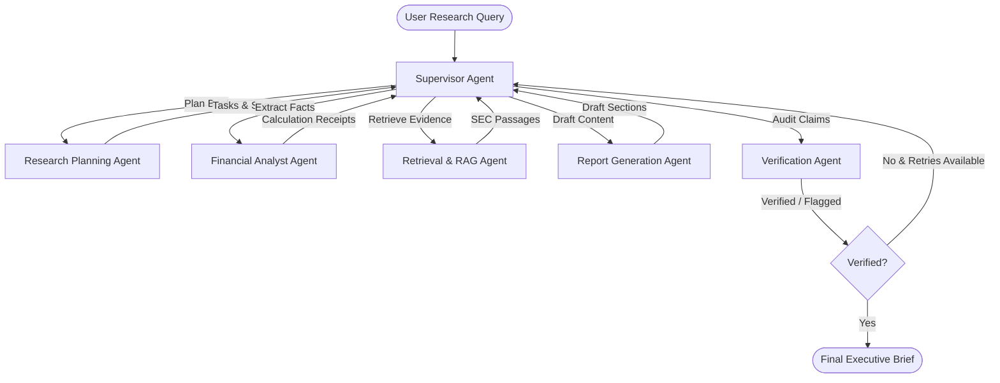

# Finova AI — Architectural Deep Dive & Financial Methodology

## 1. System Philosophy: Determinism Meets Generative Intelligence

Financial intelligence systems require an uncompromising degree of analytical rigor. In financial markets, a misplaced decimal point, an inverted growth rate, or an ungrounded revenue projection can lead to catastrophic capital misallocation.

Finova AI addresses this fundamental challenge through a **dual-engine architecture**:
1. **The Deterministic Financial Engine:** Handles quantitative truth. Ingestion of statutory XBRL facts, alignment of reporting periods, validation of currency units, mathematical computations, and audit receipts.
2. **The Generative Multi-Agent Engine:** Handles qualitative synthesis. Task decomposition, research question planning, semantic retrieval of MD&A discussions and risk factors, multi-section synthesis, and claim-level verification audits.

```
       ┌────────────────────────────────────────────────────────┐
       │                FINOVA AI DUAL-ENGINE                   │
       └───────────────────────────┬────────────────────────────┘
                                   │
         ┌─────────────────────────┴─────────────────────────┐
         │                                                   │
         ▼                                                   ▼
┌─────────────────────────────────┐         ┌─────────────────────────────────┐
│     DETERMINISTIC ENGINE        │         │      MULTI-AGENT ENGINE         │
│  - SEC EDGAR XBRL Facts Ingestion│        │  - LangGraph Supervisor Graph   │
│  - Strict Period Normalization  │         │  - Research Planning Agent      │
│  - Pure Python Math Execution   │         │  - Hybrid IR (FAISS + BM25)     │
│  - Immutable Calculation Receipts│       │  - Anti-Hallucination Verifier  │
└─────────────────────────────────┘         └─────────────────────────────────┘
```

---

## 2. Multi-Agent Orchestration via LangGraph

The multi-agent workflow is implemented as a stateful, directed graph orchestrated by a LangGraph Supervisor.



### Agent Roles & Specifications:
1. **Research Planner Agent:** Analyzes the target query, identifies the relevant ticker, fiscal periods, and required sections (Executive Summary, Segment Performance, Margins, Liquidity, Risks).
2. **Financial Analyst Agent:** Identifies required GAAP concepts (`Revenues`, `GrossProfit`, `OperatingIncomeLoss`, `NetIncomeLoss`, `NetCashProvidedByUsedInOperatingActivities`, `PaymentsToAcquirePropertyPlantAndEquipment`), queries normalized facts, and triggers deterministic calculations.
3. **Retrieval & RAG Agent:** Queries FAISS vector stores and BM25 sparse indexes to extract relevant MD&A disclosures, footnotes, and risk factors.
4. **Report Generation Agent:** Synthesizes structured sections in Markdown and HTML with provenance citations (`[E#]`, `[C#]`).
5. **Verification Agent:** Evaluates each generated assertion against cited receipts and filing excerpts, validating numeric tolerances, temporal periods, and citation integrity.

---

## 3. Deterministic Financial Calculation Methodology

### Supported Canonical Financial Ratios:
Finova AI implements 11 canonical corporate financial ratios using pure Python arithmetic:

1. **YoY Revenue Growth (%):**
   $$\text{Growth} = \frac{\text{Revenue}_t - \text{Revenue}_{t-1}}{\text{Revenue}_{t-1}} \times 100$$
2. **Gross Profit Margin (%):**
   $$\text{Gross Margin} = \frac{\text{Gross Profit}_t}{\text{Revenue}_t} \times 100$$
3. **Operating Profit Margin (%):**
   $$\text{Operating Margin} = \frac{\text{Operating Income}_t}{\text{Revenue}_t} \times 100$$
4. **Net Profit Margin (%):**
   $$\text{Net Margin} = \frac{\text{Net Income}_t}{\text{Revenue}_t} \times 100$$
5. **Operating Cash Flow Margin (%):**
   $$\text{OCF Margin} = \frac{\text{Operating Cash Flow}_t}{\text{Revenue}_t} \times 100$$
6. **Free Cash Flow (USD):**
   $$\text{FCF} = \text{Operating Cash Flow}_t - \text{Capital Expenditures}_t$$
7. **Current Ratio:**
   $$\text{Current Ratio} = \frac{\text{Current Assets}_t}{\text{Current Liabilities}_t}$$
8. **Debt-to-Equity Ratio:**
   $$\text{D/E} = \frac{\text{Total Debt}_t}{\text{Stockholders' Equity}_t}$$
9. **Long-Term Debt to Equity:**
   $$\text{LT D/E} = \frac{\text{Long-Term Debt}_t}{\text{Stockholders' Equity}_t}$$
10. **Return on Assets (ROA) (%):**
    $$\text{ROA} = \frac{\text{Net Income}_t}{\text{Average Assets}} \times 100$$
11. **Return on Equity (ROE) (%):**
    $$\text{ROE} = \frac{\text{Net Income}_t}{\text{Average Equity}} \times 100$$

### Calculation Receipts:
Every calculation outputs an immutable receipt record:
```json
{
  "receipt_id": "rcpt_aapl_gross_margin_fy2023",
  "citation_id": "C1",
  "ticker": "AAPL",
  "metric_name": "gross_profit_margin",
  "reporting_period": "FY2023",
  "calculated_value": 44.1311,
  "unit": "percent",
  "formula": "Gross Profit ($169,148M) / Total Net Sales ($383,285M) * 100",
  "inputs": [
    {"concept": "us-gaap:GrossProfit", "value": 169148000000.0, "unit": "USD"},
    {"concept": "us-gaap:Revenues", "value": 383285000000.0, "unit": "USD"}
  ],
  "verification_status": "deterministic_verified"
}
```

---

## 4. Information Retrieval & Hybrid Search Architecture


### Reciprocal Rank Fusion (RRF):
For document $d$ appearing in ranked result lists:
$$RRF(d) = \sum_{m \in \{\text{dense}, \text{sparse}\}} \frac{1}{k + r_m(d)}$$
Where $k = 60$ is the standard smoothing constant, and $r_m(d)$ is the 1-based rank of candidate $d$ in retrieval method $m$.

---

## 5. Anti-Hallucination Claim-Level Verification

Every sentence in a synthesized financial research report undergoes a 4-tier verification protocol:

1. **Extraction & Sentence Segmentation:** Isolates empirical propositions, numeric assertions, and directional statements.
2. **Numeric Precision Audit:** Matches numbers in text to cited calculation receipts `[C#]` or filing passages `[E#]`, validating that value discrepancies do not exceed the configured threshold ($\pm 1.0\%$).
3. **Temporal Period Audit:** Ensures that an assertion attributing results to "FY2023" does not cite "FY2022" or "Q3 2023" evidence.
4. **Citation Resolution Audit:** Guarantees that cited accession numbers match SEC EDGAR registry syntax and point to active SEC archive HTML files.

```
+-------------------------------------------------------------------------+
| CLAIM VERIFICATION OUTCOME TAXONOMY                                    |
+-------------------------------------------------------------------------+
| [VERIFIED]     Both numeric values and temporal periods match evidence  |
| [PARTIAL]      Semantic claim holds but secondary figure unverified     |
| [CONTRADICTED] Numerical value or direction conflicts with receipt      |
| [UNSUPPORTED]  Assertion makes factual claim without cited evidence     |
+-------------------------------------------------------------------------+
```

