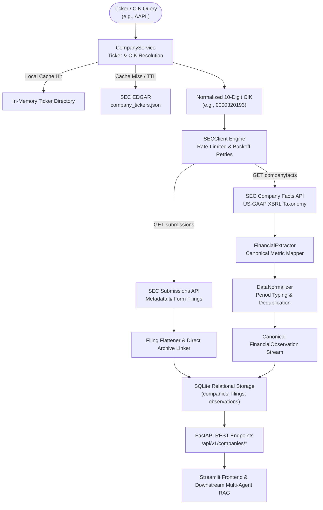
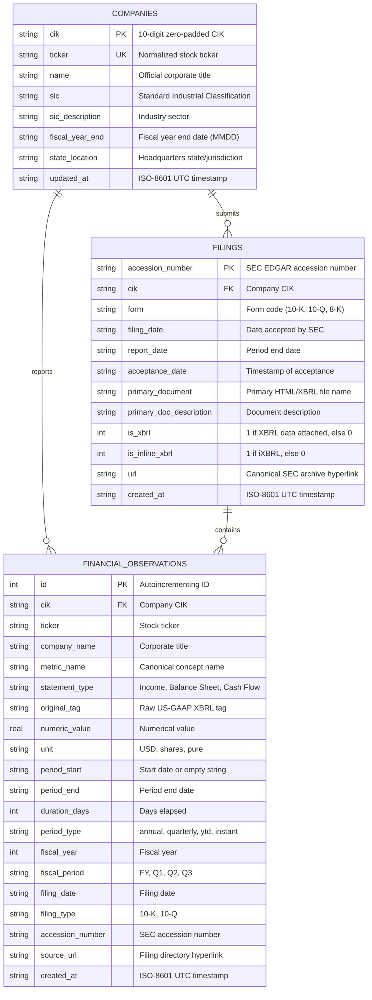

# Finova AI — SEC EDGAR Data Ingestion & Retrieval Pipeline

## 1. Overview & Architecture

The Finova AI SEC Data Pipeline is engineered to ingest, normalize, and persist corporate financial facts from official SEC EDGAR endpoints in compliance with SEC fair-access policies.



---

## 2. SEC Compliance & Fair Access Protocol

To comply with the US Securities and Exchange Commission's automated access guidelines:
1. **Declared User-Agent**: Programmatic requests must transmit a declared User-Agent containing the application name and contact email in the header:
   ```http
   User-Agent: FinovaAI-Research/0.1.0 (contact@example.com)
   Accept-Encoding: gzip, deflate
   ```
   If the configured User-Agent lacks an email address or is missing, `SECClient` raises a `SECConfigurationError` prior to dispatching any network calls.
2. **Rate Limiting**: Request dispatching is throttled to $\le 8$ requests per second (well within the SEC's 10 req/sec threshold) using monotonic interval tracking.
3. **Exponential Backoff**: Transient errors (HTTP 429 Too Many Requests or 5xx server issues) trigger exponential backoff retry cycles ($0.5 \text{s} \times 2^{\text{attempt}}$).

---

## 3. Supported Financial Metrics

Finova AI extracts standard US-GAAP taxonomy elements and maps them into canonical financial concepts:

### Income Statement
| Canonical Metric | Statement | Primary US-GAAP XBRL Tag | Fallback Alternative Tags |
| :--- | :--- | :--- | :--- |
| **Revenue** | Income Statement | `RevenueFromContractWithCustomerExcludingAssessedTax` | `Revenues`, `SalesRevenueNet`, `SalesRevenueGoodsNet` |
| **Cost of Revenue** | Income Statement | `CostOfGoodsAndServicesSold` | `CostOfRevenue`, `CostOfGoodsSold` |
| **Gross Profit** | Income Statement | `GrossProfit` | — |
| **Operating Income** | Income Statement | `OperatingIncomeLoss` | — |
| **Net Income** | Income Statement | `NetIncomeLoss` | `ProfitLoss` |
| **Earnings Per Share** | Income Statement | `EarningsPerShareDiluted` | `EarningsPerShareBasic` |

### Balance Sheet (Instant Point-in-Time)
| Canonical Metric | Statement | Primary US-GAAP XBRL Tag | Fallback Alternative Tags |
| :--- | :--- | :--- | :--- |
| **Total Assets** | Balance Sheet | `Assets` | — |
| **Current Assets** | Balance Sheet | `AssetsCurrent` | — |
| **Total Liabilities** | Balance Sheet | `Liabilities` | — |
| **Current Liabilities** | Balance Sheet | `LiabilitiesCurrent` | — |
| **Stockholders' Equity** | Balance Sheet | `StockholdersEquity` | `CommonStockholdersEquity` |
| **Cash and Cash Equivalents** | Balance Sheet | `CashAndCashEquivalentsAtCarryingValue` | `CashCashEquivalentsRestrictedCash...` |
| **Long-Term Debt** | Balance Sheet | `LongTermDebtNoncurrent` | `LongTermDebt` |

### Cash Flow Statement
| Canonical Metric | Statement | Primary US-GAAP XBRL Tag | Fallback Alternative Tags |
| :--- | :--- | :--- | :--- |
| **Operating Cash Flow** | Cash Flow Statement | `NetCashProvidedByUsedInOperatingActivities` | — |
| **Investing Cash Flow** | Cash Flow Statement | `NetCashProvidedByUsedInInvestingActivities` | — |
| **Financing Cash Flow** | Cash Flow Statement | `NetCashProvidedByUsedInFinancingActivities` | — |
| **Capital Expenditures** | Cash Flow Statement | `PaymentsToAcquirePropertyPlantAndEquipment` | `PaymentsToAcquireProductiveAssets` |

---

## 4. Period Typing & Normalization Methodology

A recurring source of error in financial LLM tools is confusing cumulative Year-to-Date (YTD) numbers with standalone quarterly metrics.

Finova AI classifies every incoming XBRL fact into one of four deterministic temporal regimes:
- **`instant`**: Point-in-time Balance Sheet figures (no start date, only end date).
- **`annual`**: Full-year flow figures spanning between 330 and 390 days, or matching form `10-K` with fiscal period `FY`.
- **`quarterly`**: Discrete three-month periods spanning between 60 and 115 days (standalone Q1, Q2, Q3, Q4).
- **`ytd`**: Cumulative multi-quarter periods reported in 10-Q disclosures spanning 150 to 310 days (e.g., 6-month Q1+Q2 or 9-month Q1+Q2+Q3).

### Deduplication & Amendment Handling
Corporate filers regularly restate figures or submit amended filings (`10-K/A`, `10-Q/A`). When duplicate observations are encountered for the composite key:
```
(company_cik, metric_name, period_end, period_type, period_start)
```
Finova AI selects the observation with the most recent `filing_date`, ensuring that amended figures cleanly supersede obsolete disclosures.

---

## 5. Relational Database Schema (SQLite)


